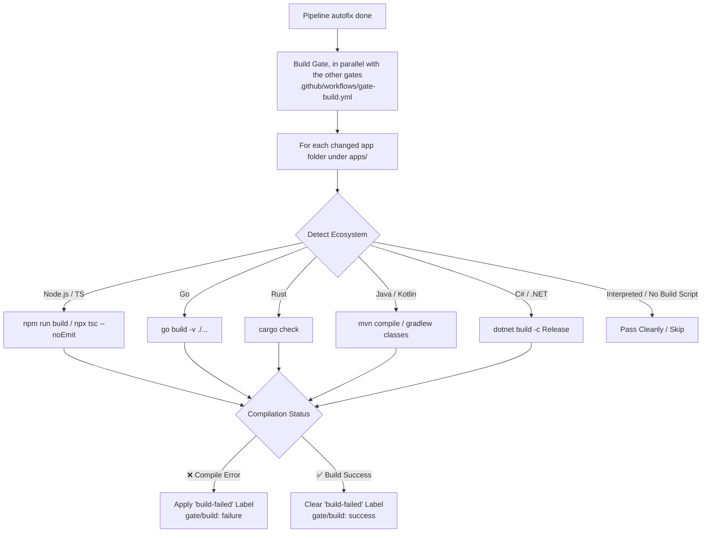

# Step 3: Polyglot Build & Compilation Verification

This gate validates that pull requests compile and build without errors before running downstream testing, security, or review steps.

---

## Architecture Overview

---

## 1. Deterministic Build Gate (`.github/workflows/gate-build.yml`)

Projects live in `apps/<app>/` (see [apps/README.md](../apps/README.md)). The build gate lists the app folders the PR changes and, inside each one, discovers its project configuration files and executes the standard compilation command. A PR that changes nothing under `apps/` (framework-only) passes cleanly; with several apps the gate stops at the first one that fails to build.

- **TypeScript / Node.js**: Discovers `package.json` build scripts (`npm run build`) or falls back to TypeScript syntax/type verification (`npx tsc --noEmit`).
- **Go**: Discovers `go.mod` and executes `go build -v ./...`.
- **Rust**: Discovers `Cargo.toml` and executes `cargo check`.
- **Java / Kotlin**: Discovers `pom.xml` (`mvn compile -q`) or `build.gradle` (`gradle classes -q`).
- **C# / .NET**: Discovers `*.csproj` or `*.sln` and executes `dotnet build -c Release`.
- **Interpreted Languages**: Python, Ruby, PHP without dedicated build commands pass cleanly.

### Fail-Fast Behavior:
- If compilation fails, the gate attaches the **`build-failed`** label.
- When compilation succeeds, the `build-failed` label is automatically cleared.
