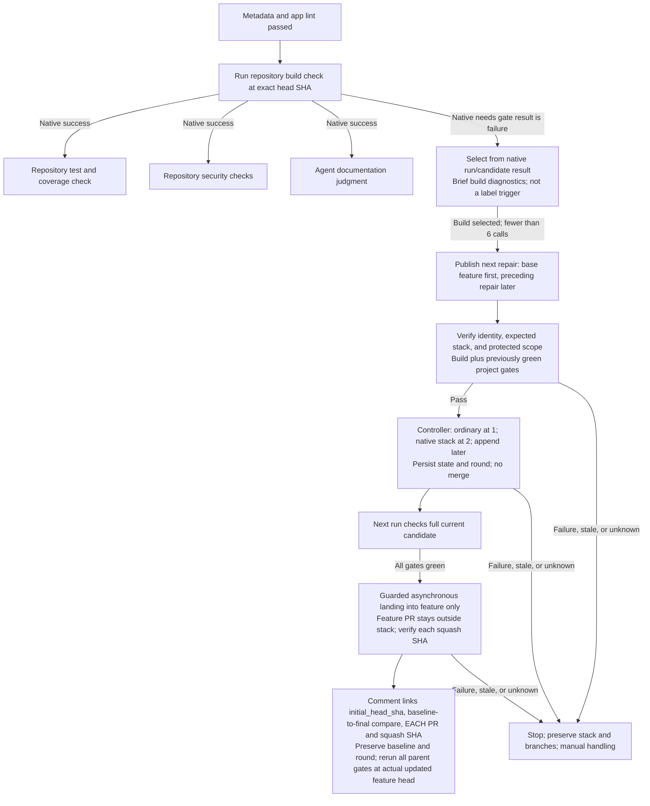

# Repository Build Check

[`pr-build.yml`](../.github/workflows/pr-build.yml) is a reusable
`workflow_call` gate between lint and the parallel test/security/documentation
stage. It runs the repository's fixed build script at the captured head SHA,
then exposes the native job result and brief diagnostics to the pipeline.

## Explicit build contract

Build behavior belongs to the repository, not a universal language-discovery
layer. Its check definitions and configuration specify the build command,
required dependencies/toolchain, build targets, and conditions for success.
The lifecycle does not infer a command from a manifest or select a fallback
based on file extensions.

The reusable adapter:

- Checks out the exact head revision rather than a mutable branch tip.
- Runs the configured repository check and preserves its exit status.
- Treats setup failures or a missing command as failures.
- Publishes brief diagnostic context without using log text to decide success.

If a project has no compilation step, its owners still define an explicit build
validation contract. The lifecycle does not grant a pass simply because it did
not recognize a language or find a familiar manifest. A skipped mandatory job
cannot satisfy readiness.

Application build validation is distinct from
[agentic workflow compilation](agentic-workflows-compilation.md), which verifies
the pinned generated workflow files independently when framework inputs change.

## Bounded repair

Native `needs.<gate>.result == 'failure'` makes build eligible for selection,
not a `build-failed` label. When build is selected under the controller's guards,
its findings are passed through `workflow_call` to the single
[`pr-repair.md`](../.github/workflows/pr-repair.md) workflow, compiled to
`pr-repair.lock.yml`. The agent receives that gate's findings and may repair within
the repository's publication policy; it cannot weaken checks or edit protected
workflow policy to obtain a pass.

The agent publishes only the next scoped repair PR, identified by native creation
output. Its base is the captured feature head for the first repair, or the
preceding repair branch/head for later layers. The feature PR targets `main`
and remains outside the stack; feature is the repair stack trunk.
The validator checks bot provenance, same-repository immutable root/member
identities, expected membership/order, and bounded/protected scope before running
build plus previously green project gates.

Inherited red or unexecuted gates remain unresolved, not certified
regression-free. Scoped success permits the controller to register a native
repair-only stack at two PRs or append later layers, **not merge**. One repair
stays ordinary. A typed artifact from a verified prior attempt of the same
workflow carries root/member snapshots, check IDs, stack number, round, and
`initial_head_sha` captured at bounded-cycle start and preserved through landing.
The next run validates the full current candidate.

Only all-green candidate gates permit guarded asynchronous squash landing into
feature, pinning the top and verifying every root/member snapshot, order, target,
and merge result. The parent comment links the initial baseline, a SHA-pinned
baseline-to-final comparison, and each repair PR and per-layer squash SHA/revert
target. Although the combined feature diff includes merged repairs, those links
distinguish the feature-original snapshot from automated additions. A single
ordinary repair uses the same asynchronous protocol. Branch
requirements remain enforced, including on intermediate layers; queues are
blocked. Errors or external changes require manual handling without unstacking,
recreating, rebasing, force-pushing, or deleting branches.

The budget is six repair calls total, including metadata; landing never resets
it. Bounded explicit dispatch starts the next exact revision's validation.
After landing, all gates rerun on the actual updated feature head, and build
must pass again before downstream stages. **`PR Quality / Ready for review`**
requires this actual-parent evidence, all six application gates, and live
head/base/metadata freshness; an unmerged candidate cannot certify feature.
`pr-status.yml` adds `build-failed` from candidate failures and clears it only
from passing actual current-parent checks. Skipped/cancelled or missing results
retain unresolved status. Labels never authorize repair or merge; fresh human
approval remains required for `main`.

See [native chaining](remediation-chaining.md) for the complete lifecycle.
