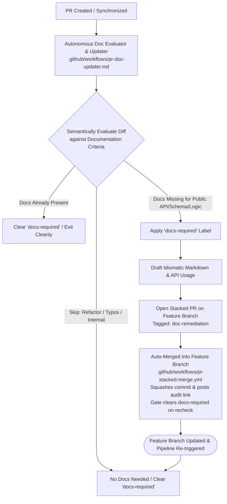

# Step 6: Semantic Documentation Evaluator & Autonomous Updater

Documentation drift is fundamentally semantic: a shell script cannot discern whether newly introduced code represents public interface changes, complex business logic, or trivial private refactoring. 

Rather than relying on brittle line counts or regex filename heuristics, this step delegates documentation evaluation to a specialized **GitHub Agentic Workflow (`.github/workflows/pr-doc-updater.md`)** that semantically comprehends code changes and authors missing documentation in a stacked pull request.

---

## Architecture Overview

---

## 1. Documentation Decision Criteria

The agent evaluates every PR diff using strict semantic rules:

### ✅ Document These:
- **Public APIs & Interfaces**: Exported functions, classes, interfaces, or HTTP/REST endpoints.
- **Complex Logic & Calculations**: Complex algorithms, non-obvious business rules, or mathematical formulas.
- **Architectural & Workflow Changes**: New CI/CD steps, state machines, or orchestrations.
- **Breaking Changes**: Changed function signatures, renamed parameters, or modified contracts.
- **New Dependencies & Integrations**: Added third-party packages, SDKs, or cloud services.
- **Security & Auth Models**: Permission changes, cryptographic rules, or authentication changes.
- **Database Schemas & Data Models**: Database migrations, entity models, or schema updates.

### ❌ Skip These (No Documentation Required):
- Minor refactorings, style updates, or lint fixes.
- Private internal helpers with straightforward implementation.
- Trivial typo fixes, comments, or variable renaming.
- Pure code moves or imports reorganization without behavior changes.
- Patch-level dependency bumps.

---

## 2. Autonomous Documentation Updater (`.github/workflows/pr-doc-updater.md`)

- **Documentation Drift Gate (`.github/workflows/pr-docs.yml`, Stage 3c)**:
  - Cheap deterministic pre-check inside the pipeline: passes when no application source changed or when Markdown documentation changed alongside the code.
  - Otherwise fails with `docs-required` and dispatches the documentation agent with the list of undocumented source files.
  - Passes when the agent recorded the semantic decision `docs-not-required`.
- **Autonomous Execution**:
  - Dispatched by the drift gate (`workflow_dispatch` with `pr_number`/`findings`).
  - Comprehends whether docs are required; if not, applies `docs-not-required` so the gate passes on the next run.
  - If required, attaches `docs-required`, writes documentation matching project conventions (`README.md`, `docs/`), and proposes changes in a stacked PR.
  - If not required or already addressed, removes `docs-required` cleanly.
- **🔒 Strict Guardrail: Documentation Files Only**:
  - The agent is **strictly prohibited from touching application code, business logic, tests, or build configuration**.
  - It only authors or modifies Markdown documentation files.
- **Stacked Pull Request**:
  - Generates all documentation changes in a single stacked pull request targeting the author's feature branch.
  - Leaves a parent PR comment directing the author to review and merge the doc updates.
1. **Analyze Diff & Public APIs**: Identifies newly added functions, exported types, configuration options, or CLI flags.
2. **Discover Existing Structure**: Discovers project documentation style in `README.md` or `docs/`.
3. **Draft Idiomatic Markdown**:
   - Usage examples and runnable snippets.
   - Parameter tables and return type contracts.
   - Behavior and architecture descriptions.
4. **🔒 Strict Guardrail: Documentation Files Only**:
   - The agent is **strictly prohibited from touching application code, business logic, tests, or build configuration**.
   - It only authors or modifies Markdown documentation files.
5. **Stacked Pull Request**:
   - Generates all documentation changes in a single stacked pull request targeting the author's feature branch.
   - Leaves a comment on the parent PR directing the author to review and merge the doc updates.
