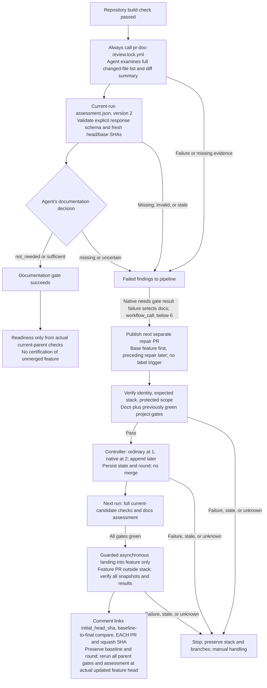

# Semantic Documentation Assessment and Native Repair

[`pr-docs.yml`](../.github/workflows/pr-docs.yml) is the reusable documentation
gate after build in full parent or candidate validation, in parallel with tests and
security. It assesses documentation need and sufficiency **for each validated
head**. Whenever the docs gate runs, it always calls the reviewer: no extension,
directory, or no-source-change
filter decides whether the agent runs. The agent, not a file heuristic, decides
whether the PR needs documentation and whether the existing documentation is
adequate.

## What semantic assessment must consider

The evaluator starts with the complete changed-file list and a diff summary,
then inspects focused changes and relevant existing documentation, including
documentation already present before the PR. It decides what matters
semantically, grouping related changes rather than producing a checklist for
every file. Its evidence-based findings should consider:

- Public APIs, exported interfaces, endpoints, configuration, and CLI behavior.
- Non-obvious business rules and consequential behavior changes.
- Architecture, workflow orchestration, operational setup, and deployment changes.
- Breaking contracts and migration requirements.
- Dependencies and integrations with user-visible or operational consequences.
- Security/authentication models, permissions, and data/schema changes.

Some changes need no documentation update: a behavior-preserving private
refactor, a typo correction, or a routine dependency patch can be examples.
They are not unconditional filename/category exemptions. Tests, generated files,
lockfiles, deletions, and documentation-only changes are not filtered out before
review. The evaluator judges their actual implications for the current revision.

## Fresh decisions, not label or filename shortcuts

- An unrelated Markdown edit cannot satisfy documentation requirements for
  changed APIs, configuration, or workflows.
- A historic `docs-not-required` label cannot waive evaluation for a new head.
  `docs-required` is visible status maintained from native results, not a
  trigger or waiver.
- Documentation already present can be adequate, but that conclusion must follow
  inspection of its relevance and accuracy, not just a changed-file count.
- Only the agent can return `not_needed`, with an explanation. There is no
  deterministic "no source/configuration change" exemption, Markdown-presence
  count, or source-classification waiver.
- A missing, failed, cancelled, or skipped assessment cannot be treated as an
  agent decision.
- The assessment must belong to the immutable revision being validated.
  Stale or incomplete assessment evidence must not produce a successful gate.

The reusable gate reports its result and findings to the pipeline. It does not
dispatch repairs or manage labels.

## Implemented evaluator and artifact contract

In full parent or candidate validation, the gate follows build. In scoped repair
validation, it runs when docs is selected or was previously green. In every
case, the gate always calls
[`pr-doc-review.md`](../.github/workflows/pr-doc-review.md), compiled to
`pr-doc-review.lock.yml`, through `workflow_call`. This is a separate **read-only
evaluator**, not another repair agent. It cannot edit files, publish GitHub
changes, or change gate policy. It receives the unfiltered changed-file list for
the immutable comparison diff and makes the documentation judgment.
Its only grant beyond read permissions is `copilot-requests: write` for model
inference.

The callable workflow requires string inputs `pr_number`, `head_ref`, `head_sha`,
`base_ref`, and `base_sha`, and accepts optional `comparison_base_sha`.
The evaluator runs no tests, installs no dependencies, and cannot change the
configured model.

### PR identity versus comparison base

`base_sha` always identifies the assessed PR's immediate base. Normally the
comparison also starts there. The first repair's immediate base is the captured
**feature head**; later repairs use the **preceding repair head**. For full
feature assessment on any repair layer, `comparison_base_sha` is the captured
**root feature PR's original base SHA**, not the preceding repair. This lets
the agent assess the complete feature plus every candidate repair, not only
the newest small diff.

The cycle-start `initial_head_sha` serves the repair-origin audit only. It does
not replace this root-base comparison: assessing only the automated additions
would omit the feature's original documentation obligations.

The optional comparison input does not replace immediate PR identity checks:
the live repair base must still match the captured feature or preceding repair
head as appropriate, and the root snapshot must remain unchanged. The effective
comparison base defaults to `base_sha` and is recorded/validated in the
assessment artifact. No deterministic source eligibility or per-file checklist
is introduced by this comparison.

The evaluator must submit exactly one typed `docs_assessment` safe-output request.
The deterministic publisher rechecks the live PR identity/head/base and validates
the explicit response schema. It does not classify source files, enforce a
per-file checklist, or independently decide documentation need. It publishes:

- **Artifact:** `pr-doc-assessment-<head_sha>-<base_sha>`, from the current run.
- **File:** `assessment.json`.

| Field                  | Meaning                                                                                                  |
| :--------------------- | :------------------------------------------------------------------------------------------------------- |
| `version`, `pr_number` | Artifact schema version (`2`) and assessed PR number as a string.                                        |
| `head_sha`, `base_sha` | Exact PR head and immediate base identity; the comparison base is recorded separately.                   |
| `comparison_base_sha`  | Effective comparison base; defaults to `base_sha`, or the original feature base for a repair assessment. |
| `decision`             | `not_needed`, `sufficient`, `missing`, or `uncertain`; the agent's semantic judgment.                    |
| `findings`             | Nonempty semantic findings, bounded to 6,000 characters.                                                 |

The agent returns one PR-level decision:

- **`not_needed`:** no documentation update is required; explain why.
- **`sufficient`:** documentation is needed and existing documentation adequately
  covers the change; identify the relevant documents and behavior examined.
- **`missing`:** documentation is needed but absent or inaccurate; identify the
  expected location and specific missing content.
- **`uncertain`:** the available evidence or runtime budget does not establish
  need or sufficiency; explain the blocker rather than infer a pass.

**A successful evaluator job means an explicit valid decision was produced;
it does not mean documentation passed.** The wrapper downloads the current
run's artifact and validates schema version, PR identity, exact head/base SHAs,
the effective comparison base, decision enum, and nonempty bounded findings. It maps **`not_needed` and
`sufficient` to pass**, and **`missing` and `uncertain` to fail**. This is response
and freshness validation, not a second deterministic documentation judgment.
Failed/missing downloads, a failed/cancelled/skipped required assessor,
malformed JSON, or incomplete/schema-invalid/stale evidence
all fail the documentation gate.

The evaluator exposes no reusable outputs; there is deliberately no
`needs.assess.outputs.assessment` interface.
The installed gh-aw `v0.89.21` does not support that custom reusable-output
contract or a standalone native `set-output` capability. The typed safe-output
job plus artifact is the minimal integration needed to carry the verdict to its
deterministic consumer. Neither arbitrary Markdown nor a label is accepted as
the result.

## Confirmed evaluator runtime controls

| Component        | Configured ceiling                                                                                                 |
| :--------------- | :----------------------------------------------------------------------------------------------------------------- |
| Main inference   | 20 LLM calls (`maxRuns=20`), eight-minute inference timeout, 20 AI credits, cache-miss cap of three.               |
| Agent job        | 15-minute job timeout; this is separate from the inference timeout.                                                |
| Harness recovery | One retry after five seconds; no model switching.                                                                  |
| Threat detection | Four turns, 90-second attempt timeout, zero retries, five AI credits, five-minute job timeout; errors fail closed. |

The model comes from repository variable `GH_AW_AGENT_MODEL`, falling back to
`gpt-4.1`. These controls are execution ceilings, not expected elapsed times,
token-consumption estimates, or a promise that the full workflow completes
within the inference timeout.

## Scoped documentation repair PRs

The native `needs.<gate>.result == 'failure'` makes docs eligible for repair;
a `docs-required` label does not. When docs is selected and controller guards
pass, the pipeline calls [`pr-repair.md`](../.github/workflows/pr-repair.md)
through `workflow_call`, passing the gate's findings. It is compiled as
`pr-repair.lock.yml`. The shared repair workflow handles one selected gate per
round; it does not bundle unrelated failures into the documentation repair.

Documentation repairs should follow repository conventions, update relevant
examples and links, and describe implemented behavior without claiming
verification that did not occur. Native publication creates the next scoped
repair PR, and its output supplies the authoritative identity. The agent
publishes only the next repair: base feature for the first,
preceding repair branch for later layers. The feature PR targets `main` outside
the repair-only stack, whose trunk is the feature branch; no direct feature
code push is permitted.

`pr-validate-repair.yml` checks bot provenance, same-repository immutable
root/member identities, expected stack membership/order, and bounded/protected
scope. It reruns docs and previously green project gates. Inherited red or
unexecuted gates remain unresolved, not certified regression-free.

After scoped success, planned controller module `pr-register-repair-stack.yml`
registers two repairs as a real native stack or appends later layers. One repair
stays ordinary because GitHub requires at least two for a native stack.
**No merge occurs yet.** Typed state from a verified prior attempt of the same
workflow records the root snapshot, ordered entries/check IDs, native stack
number, consumed round, and `initial_head_sha` captured once at bounded-cycle
start and preserved through landing. This is distinct from the evaluator's decision
artifact; logs and agent decisions cannot authorize continuation.

The next run checks the full current candidate, including semantic docs
assessment. Only all-green candidate gates permit `pr-land-repair-stack.yml` to
pin the top and verify every root/member snapshot, check ID, order, trunk, and
target before guarded asynchronous squash landing into feature. The single
ordinary repair uses the same asynchronous path. Verify each merged repair and
squash SHA, then comment on feature linking the initial baseline,
baseline-to-final SHA comparison, each repair PR and per-layer squash SHA/revert
target, and validation evidence, with full parent revalidation pending. The
combined feature diff includes merged repairs; these references distinguish
the feature-original snapshot from automated additions.

Bounded explicit dispatch starts validation of the next exact revision.
All parent gates rerun on the actual updated feature head, including a new
semantic assessment when normal dependencies succeed. Neither the repair
agent's assertion nor candidate/scoped success certifies the unmerged feature.
Preserve branches and budget after landing.

## Readiness and limits

**`PR Quality / Ready for review`** requires all six actual-parent application
quality gates, and the live head/base/title-body hash, with no unmerged repairs.
Missing, skipped, cancelled, failed, or stale evidence fails readiness even if
the documentation agent reported success elsewhere.

A cycle allows at most six repair calls total, including metadata and failed
calls; landing never resets the budget. Unknown bot repairs block duplicates
and cannot be adopted from a PR list. Missing state, changed snapshots,
conflicts, scope failures, API/poll errors, or partial external landing stop
explicitly for manual handling. Preserve stacks/branches; do not unstack,
recreate, rebase, or force-push to recover. Enforce feature-branch requirements
on all intermediate layers without weakening them, and block merge queues.

`pr-status.yml` adds `docs-required` from candidate failures and clears it only
from passing actual current-parent checks. Skipped/cancelled or missing results
retain unresolved status, and labels never authorize repair or merge.
Fresh human approval and readiness remain required before `main`.

See [native chaining](remediation-chaining.md) and
[human review handoff](pr-review-and-consolidation.md).
