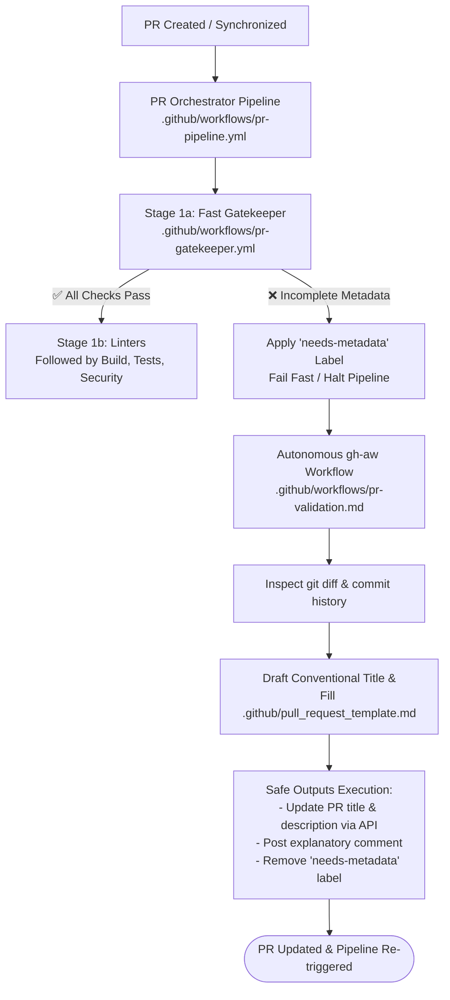

# Step 1: PR Gatekeeper & Autonomous PR Validation

This step implements a fail-fast pre-flight check combined with an autonomous AI remediation loop for pull request metadata, naming conventions, and template compliance.

---

## Architecture Overview

---

## 1. Fast Gatekeeper (`.github/workflows/pr-gatekeeper.yml`)

The gatekeeper acts as the deterministic first line of defense before any expensive parallel test suites, CodeQL scans, or builds execute.

- **Lightweight Execution**: minimal standard GitHub Actions runner minutes, **zero AI tokens** and 
- **Pre-Flight Validations**:
  - **Branch Naming**: Enforces standard prefixes (`feat/*`, `fix/*`, `chore/*`, `docs/*`, `test/*`, `refactor/*`, `ci/*`).
  - **PR Title**: Enforces [Conventional Commits](https://www.conventionalcommits.org/) format (e.g. `feat(scope): description` or `fix: description`).
  - **PR Description**: Verifies that the PR body is not empty (at least 20 characters) and placeholder text has been replaced.
- **Fail-Fast & Triggering Remediation**:
  - If title or description checks fail, it automatically applies the **`needs-metadata`** label to the PR.
  - Generates an actionable markdown summary table in the Actions Job Summary with instructions for the author.
  - Fails the job immediately to halt downstream workflows until metadata is resolved.

---

## 2. Autonomous `gh-aw` Assistant (`.github/workflows/pr-validation.md`)

When a developer submits a PR with missing context or a non-standard title, this GitHub Agentic Workflow autonomously steps in to remediate it.

- **Trigger**: Activates automatically when the **`needs-metadata`** label is added to a PR (or manually via `workflow_dispatch`).
- **Semantic Code Understanding**:
  - Uses `gh pr diff` and `gh pr view` via pre-authenticated `gh-proxy` to read code changes, modified files, and commit logs.
  - Uses `.github/pull_request_template.md` as its strict layout contract.
- **Autonomous Resolution**:
  - Drafts an accurate Conventional Commit title matching the actual changes.
  - Fills in the PR template sections: **Summary**, **Type of Change**, **Linked Issues**, and **Verification**.
- **Safe Outputs Execution**:
  - `update-pull-request`: Atomically updates the PR title and description.
  - `add-comment`: Adds a transparent comment explaining the generated metadata and inviting the author to review.
  - `remove-labels`: Removes the `needs-metadata` label to unblock the gatekeeper.
