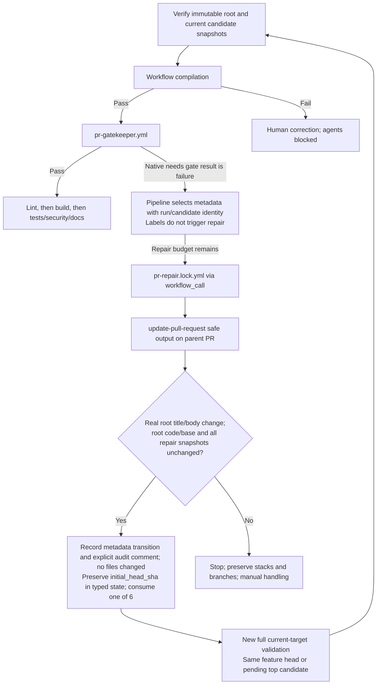

# PR Metadata Gate and Native Repair

[`pr-gatekeeper.yml`](../.github/workflows/pr-gatekeeper.yml) is the metadata quality
gate after the pipeline resolves the immutable PR revision and verifies workflow
compilation. It runs through
`workflow_call`; it does not listen for labels, dispatch agents, or edit the PR.

## Entry and execution order

[`pr-start.yml`](../.github/workflows/pr-start.yml) handles supported feature-PR
events and dispatches [`pr-pipeline.yml`](../.github/workflows/pr-pipeline.yml).
Initial validation uses the same-repository feature head; a verified
continuation uses the top repair candidate while also verifying the root
feature snapshot. The dispatch ref and `github.sha` must match the captured
validation target. Metadata policy always applies to the root feature PR,
including its branch identity and title/body hash.

Workflow compilation must pass before metadata, followed by lint, build, and
parallel deep checks. Compilation failure blocks agents and requires human
correction. The feature PR targets `main` outside the repair-only native stack;
feature is the stack trunk, not `main`.

## Repository-owned metadata policy

The gate reads the live root PR and rejects a head branch/SHA mismatch. The repository
owns the metadata rules: branch conventions, title format, required description
content, and unacceptable placeholders. Its check definition and PR template
are the source of truth, rather than a universal naming scheme in the lifecycle.

These checks establish configured policy compliance, not proof that every
description is accurate or every template field is meaningful. The gate reports
a native GitHub conclusion; failure stops downstream stages. Brief findings
and job summaries provide diagnostic context without becoming a second verdict
based on log text.

## Repairing the parent PR

The single [`pr-repair.md`](../.github/workflows/pr-repair.md) workflow replaces the
old dedicated metadata agent. When metadata is the selected failing gate, its
compiled `pr-repair.lock.yml` receives that gate's findings through `workflow_call`
and uses `update-pull-request` to correct the existing PR's title/body.
This is the exception to code/docs repair-stack publication: metadata-only changes
must not push code or create a fake empty PR.

Metadata should describe the actual diff, follow the repository's PR template,
and distinguish verification performed from verification still needed. The agent
must not invent linked issues or claim tests passed without evidence. Renaming
an invalid head branch requires author intervention; title/body edits cannot
repair that finding.

A successful update does not itself clear a label or turn the failed gate green.
The controller verifies real title/body progress with unchanged root code/base
and all existing member snapshots, then records the authorized metadata
transition in typed state from a verified prior attempt of the same workflow.
That state carries the root snapshot, ordered entries/check IDs, native stack
number, consumed round, and **`initial_head_sha`** captured at bounded-cycle start.
The initial baseline remains unchanged through later native landing; logs and
agent decisions are not continuation state.

The title/body update also receives an explicit audit comment on the feature
PR describing the metadata change, linking its validation run and baseline,
and recording that the code head is unchanged, no files changed, and revalidation
is pending. This is the only no-file-PR case: **all automated file changes,
including lint, still require separate repair PRs**.

The new run uses the verified new metadata hash and reruns compilation, metadata,
and all subsequent gates against the full current target. With pending repairs,
this is the top candidate, not the unchanged feature head. Metadata calls count
toward the **same six-call total** as code/docs repairs, including failed/no-op
calls. Neither metadata repair nor later landing resets the budget.

An unexpected snapshot change, missing state, API failure, or partial external
landing stops explicitly. Preserve stacks and branches for manual handling; do
not adopt arbitrary PRs, publish duplicates over unrecognized bot repairs, or
unstack/recreate/rebase/force-push to recover automatically.

For code/docs, the first repair targets feature and later repairs target the
preceding repair branch. After identity/protected-scope checks and selected plus
previously green gates pass, the controller registers native metadata at two
repairs or appends later layers, without merging. One repair stays ordinary.
The next full candidate must be all green before guarded asynchronous landing
into feature, followed by an audit linking each repair PR and squash SHA and
the initial baseline plus baseline-to-final comparison, then rerunning all parent
gates at the actual updated feature head.

The pipeline selects metadata from native `needs.<gate>.result == 'failure'`
and invokes repair through `workflow_call`; bounded explicit dispatch starts the
next validation. Mutable, non-SHA-bound labels are only a view of these native
results, and `GITHUB_TOKEN`-created label events generally do not trigger runs.
See [the trigger rationale](remediation-chaining.md#what-triggers-a-repair-and-why-not-labels).

## Readiness

The required check **`PR Quality / Ready for review`** requires successful
actual-parent context, compilation, and all mandatory gate conclusions, with
live head/base/metadata matching the snapshot and no pending unmerged repairs.
Candidate checks cannot certify the unmerged feature PR. A metadata edit during
validation makes the snapshot stale even if no commit changed.
`pr-status.yml` adds `needs-metadata` from candidate failures and clears it only
from a passing actual current-parent check. Skipped, cancelled, or missing
evidence retains unresolved status. Labels never authorize repair or waive
validation. Feature-branch requirements remain enforced on intermediate repairs;
merge queues are blocked, and `main` still requires fresh human approval.

See [native chaining and the six-call budget](remediation-chaining.md) and
[human review handoff](pr-review-and-consolidation.md).
