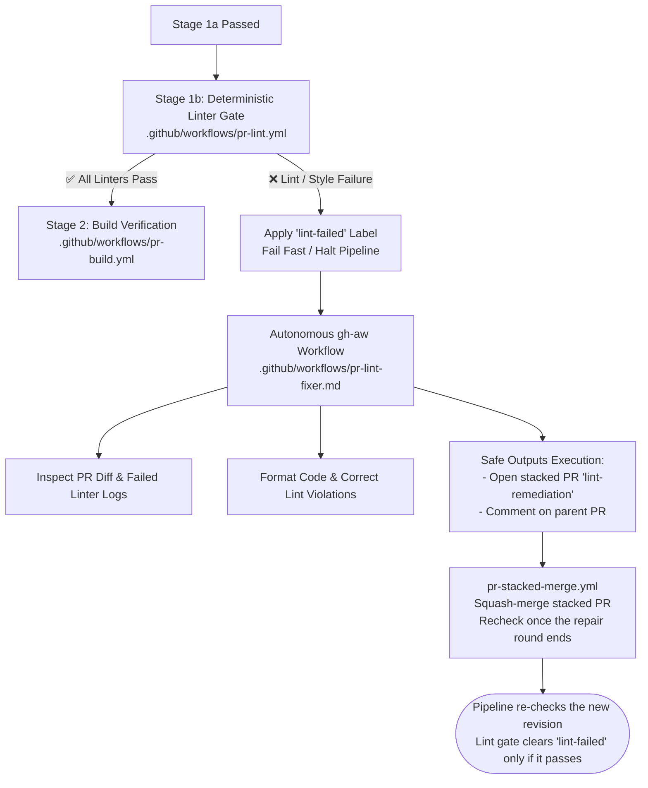

# Step 2: Polyglot Linting & Autonomous Style Remediation

This step implements a language-agnostic code quality gate combined with an autonomous AI remediation loop for formatting, styling, and static linting errors.

---

## Architecture Overview

---

## 1. Deterministic Gate (`.github/workflows/pr-lint.yml`)

The linter gate uses GitHub's official **Super-Linter** to provide out-of-the-box linting across any programming language without manual per-language tooling setup.

- **Universal & Polyglot**: Automatically detects languages in the repository (JavaScript, TypeScript, Python, Go, Rust, Java, C#, Shell, JSON, YAML, etc.) and executes the appropriate linters.
- **Tuned & Noise-Free**:
  - Excludes noisy non-code linters (`VALIDATE_CHECKOV: false`, `VALIDATE_MARKDOWN: false`, `VALIDATE_NATURAL_LANGUAGE: false`, `VALIDATE_JSCPD: false`) to keep focus on code logic and formatting.
  - Skips internal metadata paths (`.github/`, `docs/`, `*.lock.yml`, and temp logs) via `FILTER_REGEX_EXCLUDE`.
- **Diff-Aware**: Sets `VALIDATE_ALL_CODEBASE: false` to only inspect changed files in the PR, minimizing runtime and avoiding legacy repo-wide noise.
- **Fail-Fast & Triggering Remediation**:
  - If any linter detects errors, the workflow marks the job as failed and automatically attaches the **`lint-failed`** label to the PR.
  - If all linters pass (or after autonomous fixes are applied), it clears the `lint-failed` label.

---

## 2. Autonomous `gh-aw` Remediation Loop (`.github/workflows/pr-lint-fixer.md`)

When formatting or style issues break the build, this GitHub Agentic Workflow automatically remediates the files rather than forcing developer context-switching.

- **Trigger**: Activates automatically when the **`lint-failed`** label is added to a PR (or manually via `workflow_dispatch`).
- **Log & Code Analysis**:
  - Inspects `gh pr diff` and recent linter failure logs from `pr-lint.yml`.
  - Pinpoints exact syntax, whitespace, import ordering, or style discrepancies reported by the linter.
- **Safe Outputs Execution**:
  - `create-pull-request`: Opens a stacked PR (labelled `lint-remediation`, title prefix `style(lint): `) targeting the author's feature branch with the formatting and lint fixes.
  - `add-comment`: Posts a summary on the parent PR of which files were formatted and which lint rules were corrected.
- **Auto-merge**: The agent's `conclusion` job dispatches `pr-stacked-merge.yml`, which squash-merges the stacked PR into the feature branch, posts an audit comment with the merged commit on the parent PR, and — once the repair round is over — re-runs the PR Quality Pipeline on the new revision. The `lint-failed` label is only removed by the Lint gate when the re-check passes.
