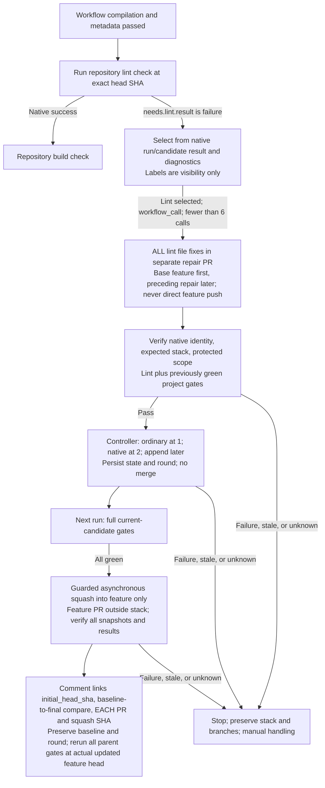

# Repository Lint Checks and Native Repair

[`pr-lint.yml`](../.github/workflows/pr-lint.yml) is a reusable `workflow_call`
gate after workflow compilation and metadata, and before build. It invokes the
repository's explicitly configured lint script at the immutable PR head.
[`pr-pipeline.yml`](../.github/workflows/pr-pipeline.yml) owns ordering and repair;
the lint gate does not dispatch workflows or manage labels.

## Repository-owned lint policy

The lifecycle is language-neutral; it does not choose linters by inspecting
extensions or manifests. The repository's check definitions and configuration
are the source of truth for:

- The fixed lint command and its required toolchain.
- Formatting and static-analysis rules.
- Files included or excluded, and whether the check covers a diff or the
  complete repository.
- Which findings produce a failing exit status.

The reusable workflow is a thin adapter around that command. It checks out the
exact head SHA and preserves command/setup failures as native GitHub job
failures. A missing configured command is an error, not a reason to select
another tool or silently pass.

Brief logs and findings help diagnose the failure and guide repair. They do
not determine the result: the orchestrator neither searches for error-like
words in logs nor infers success from an empty diagnostic excerpt.

Secret scanning is a separate [security check](pr-security-and-fixer.md), not
an implied property of passing lint.

## Repair and revalidation

The pipeline selects from native **`needs.<gate>.result`** failures. In particular,
**`needs.lint.result == 'failure'`**, not the presence of `lint-failed`, makes
lint eligible. If lint is selected and identity/state/budget guards pass, it calls
[`pr-repair.md`](../.github/workflows/pr-repair.md), compiled to
`pr-repair.lock.yml` via `workflow_call` with that gate's findings. Repairs should address the repository's reported rules
without unrelated changes or weakening the check configuration.

**Lint and formatting are not exceptions:** every automated lint file change
must have its own scoped repair PR, just like all other automated file repairs.
No direct feature-branch push, amendment of the original feature commits, or
"small formatting fix" shortcut is allowed.

The agent publishes only the next repair PR; native creation output supplies its
identity. The first repair targets feature and later repairs target the preceding
repair branch. The feature PR targets `main` outside the native stack, whose
trunk is feature. `pr-validate-repair.yml` checks bot provenance, same-repository
immutable root/member identities, expected membership/order, and
bounded/protected file scope.

Scoped validation reruns lint and previously green project gates. Inherited
red or unexecuted gates remain unresolved, not certified regression-free.
After scoped success, the controller registers a native repair-only stack at two
PRs or appends later layers; it does not merge. A single repair remains ordinary.
Typed state from a verified prior attempt of the same workflow records root
snapshot, ordered entries/check IDs, native stack number, repair round, and
**`initial_head_sha`** captured at bounded-cycle start. Native landing never
changes that initial baseline.

The next run checks the full current candidate. Only all-green candidate gates
permit guarded asynchronous squash landing into feature, for either the native
stack or single ordinary repair. The controller pins the top, verifies every
root/member snapshot, order, target, and result. Its feature comment links the
initial baseline, a baseline-to-final feature comparison, and each repair PR
and per-layer squash SHA/revert target. The combined feature diff includes the
merged lint changes; those links distinguish original work from automated
additions. Bounded explicit dispatch then reruns all gates at the actual updated
feature head. Candidate success cannot certify an unmerged feature PR as
**`PR Quality / Ready for review`**.

Feature-branch requirements can block intermediate layers; never weaken them.
Queues are blocked. Stale snapshots, conflicts, scope errors, API/poll failures,
or missing state stop with stacks and branches preserved; manual handling replaces
automatic unstack/recreate/rebase/force-push recovery.

`pr-status.yml` adds `lint-failed` from candidate failures and clears it only from
passing actual current-parent checks. Skipped/cancelled or missing results retain
unresolved status. Labels never trigger or authorize repair: token-created label
events generally do not start runs, and mutable labels carry no SHA-bound
diagnostics. Native results retain run/candidate identity; see
[the trigger rationale](remediation-chaining.md#what-triggers-a-repair-and-why-not-labels).
Six repair calls total include
metadata; landing does not reset the budget. See
[native chaining](remediation-chaining.md) and
[fresh human approval before main](pr-review-and-consolidation.md).
