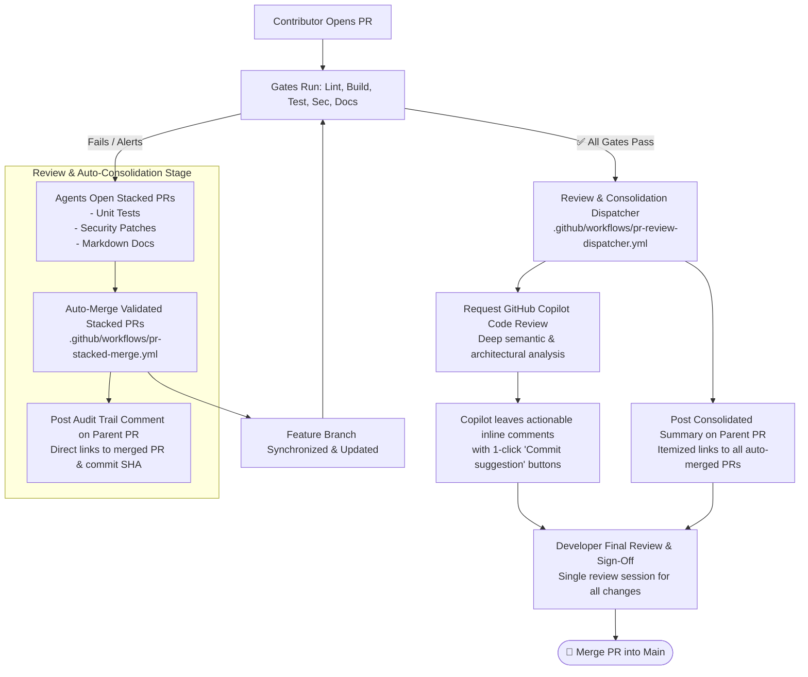

# Step 7: Automated Consolidation, Copilot Review & Developer Sign-Off

This module solves **notification and review fatigue** by automatically consolidating agentic stacked PRs into the developer's branch with transparent audit trails, requesting GitHub Copilot semantic review, and guiding the developer through a single final sign-off.

---

## 💡 Why This Framework is Relevant: Solving Review Fatigue

Without consolidation, autonomous agents running in parallel can overwhelm engineers with disjointed pull requests, repetitive CI runs, and constant context switching:

- **Zero Human Churn**: Developers aren't interrupted every 5 minutes to review 4 minor stacked PRs. The pipeline auto-merges them into the feature branch.
- **Auditability & Traceability**: Because each agent created its own stacked PR, there is a clean git history and PR record for *why* a test was added or a security patch was merged.
- **Transparency via Comments**: Commenting on the parent PR keeps the author informed of everything that was auto-merged.
- **Final Single Review**: Copilot reviews the final, clean, remediated branch, and the human author only does **one comprehensive review** of all auto-remediated changes plus Copilot's review feedback.

### Impact on Delivery & Velocity

| Metric | Traditional Human-Only CI/CD | Our Autonomous PR Lifecycle |
| :--- | :--- | :--- |
| **Average Time-to-Merge (TTM)** | **2 to 5 business days** (waiting for peer reviewers to wake up, point out missing tests, request formatting fixes, wait for changes, re-review) | **15 to 45 minutes** |
| **CI/CD Pipeline Run Time** | 3 to 10 minutes per push | 2 to 5 minutes per push |
| **Review Cycles** | 3–4 back-and-forth round trips over days | **1 single review session** by the developer |

---

## Architecture Overview

---

## 1. Stacked PR Auto-Merger (`.github/workflows/pr-stacked-merge.yml`)

Instead of pinging the developer to manually review and merge 3–4 separate stacked PRs:
- **Automatic Ingestion**: Automatically merges valid remediation PRs with labels (`test-remediation`, `security-remediation`, `doc-remediation`) targeting the feature branch.
- **Squash & Delete**: Squashes the remediation commit into the developer's feature branch and deletes the temporary agent branch.
- **Transparent Audit Trail**: Posts a comment directly to the parent PR:
  > **🤖 Autonomous Remediation Auto-Merged**:
  > - **Stacked PR**: [#12 - test: add unit test coverage for PR changes](url)
  > - **Merged Commit**: [`a1b2c3d`](url)

---

## 2. Review & Consolidation Dispatcher (`.github/workflows/pr-review-dispatcher.yml`)

Once all automated checks pass and all stacked PRs are settled:
- **Verifies All Gates Passed**: Confirms zero blocking labels (`needs-metadata`, `lint-failed`, `build-failed`, `test-required`, `docs-required`, `codeql-alert`, `dependency-alert`, `secret-alert`).
- **Requests GitHub Copilot Code Review**: Automatically dispatches `@copilot` to perform deep architectural and semantic review.
- **Posts Consolidated Summary**:
  - Itemizes every auto-merged remediation PR and commit with direct links.
  - Instructs the developer to review Copilot's inline suggestions and give final approval to merge.
