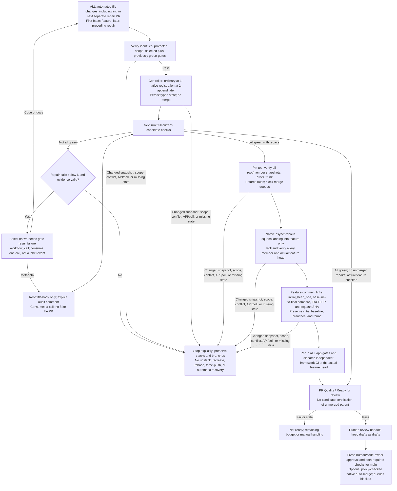

# Repair-Only Stack Landing and Human Review

The feature PR targets `main` and remains **outside** the native repair stack.
The feature branch is the stack trunk: the first repair targets feature, and
later repairs target the preceding repair branch. At two validated repair PRs,
the controller registers a real GitHub-native stack and appends subsequent
validated layers. One repair stays ordinary because the native minimum is two.
Metadata-only title/body updates stay on the feature PR without an empty PR.
**Lint and every other automated file change get a separate repair PR**; neither
formatters nor repair agents may push file changes directly into feature.

This is the intended controller contract, not a deployment or live-policy claim.
The planned modules are `pr-register-repair-stack.yml` and
`pr-land-repair-stack.yml`; the agent publishes the next PR only and never owns
stack metadata or landing.

## Three different validation boundaries

### 1. Scoped repair validation and registration

[`pr-validate-repair.yml`](../.github/workflows/pr-validate-repair.yml) consumes
the authoritative identity returned by native PR creation. It checks bot
provenance, same-repository immutable root/member identities, immediate
base/head ancestry, expected stack membership/order/trunk, and bounded/protected
file scope. The feature PR must not be a stack member.

It executes the **selected gate plus previously green project gates**. Every
required scoped check must succeed before **`Scoped repair validation`** passes
on the repair head. Inherited red or unexecuted gates remain unresolved, not
certified regression-free.

Scoped success permits registration/append and a new full candidate run, **not
an immediate merge**. The first layer remains ordinary; the second establishes
the repair-only native stack. The controller verifies the resulting stack and
persists a small typed continuation artifact with the root snapshot, ordered
repair identities/check IDs, stack number, and consumed repair round.
It also preserves **`initial_head_sha`**, captured once at bounded-cycle start,
even after landing changes the current root head. Only a verified prior attempt
of the same workflow may supply that state.

The repair trigger is a native `needs.<gate>.result == 'failure'` selected by
the pipeline under its guards, followed by `workflow_call`, not a failure label.
Explicit bounded dispatch validates the next exact candidate or feature head.
See [why labels do not trigger repairs](remediation-chaining.md#what-triggers-a-repair-and-why-not-labels).

### 2. Full candidate checks and guarded landing

The next run evaluates all six application gates on the complete current top
candidate through normal dependencies. Root metadata stays bound to its
snapshot; project checks evaluate the full feature plus repairs. A candidate
pass cannot make an **unmerged** feature PR ready.

Only an all-green full current candidate may reach `pr-land-repair-stack.yml`.
The controller pins the top SHA and verifies **every** root/member snapshot,
native check identity, member order, stack number, and feature trunk/target.
The feature PR is not merged, and there is no native-stack path to `main`.

The controller requests squash landing of the top repair through GitHub's
**asynchronous merge API**. For a native stack, all repairs land atomically in
ascending order into feature, each with its own squash commit. A single ordinary
repair uses the same guarded asynchronous API. Neither the legacy synchronous
merge endpoint nor a loop of separate ordinary merges is a fallback.

API acceptance is not a successful landing: rules are evaluated during
execution. Bounded polling must confirm success, each repair's merged result
and squash SHA, and the actual feature head/history, with root identity, base,
and metadata unchanged. The feature comment links the **`initial_head_sha`
baseline**, a **SHA-pinned comparison from that baseline to the final feature
head**, and **each repair PR and each per-layer squash SHA/revert target**,
alongside scoped evidence and the full candidate run. It explicitly distinguishes
feature-original work from this cycle's automated additions and states that
parent revalidation is pending.
Keep the stack/branch evidence; do not delete repair branches.

### 3. Full validation of the updated parent

After confirmed landing, the controller advances the recorded root snapshot to
the verified actual feature head and dispatches a full parent run plus independent
framework CI. **All six application gates rerun**; framework CI classifies the
full feature diff and runs only its applicable checks. The consumed repair round survives landing;
it is not reset by the bot. A metadata-only repair likewise requires new full
validation of the current target after its controlled metadata transition.
That metadata-only update gets its own explicit audit comment describing the
title/body change, unchanged code head and initial baseline, and pending
revalidation. It does not create a fake file-change PR.

The native check named exactly **`PR Quality / Ready for review`** requires:

1. Successful immutable root PR context validation.
2. All six application quality gates: metadata, lint,
   build, test, security, and documentation, on the actual current feature.
3. A still-open feature PR whose live head/base SHAs and title/body hash match
   the validated snapshot, with no pending unmerged repairs.

Failed, skipped, cancelled, missing, or stale mandatory evidence fails readiness.
An agent assertion, label, comment, scoped check, old check, or all-green unmerged
candidate cannot replace this evidence. Independent `Framework CI / Required`
must also succeed before merging. On app-only changes it reports a not-needed
success without installing a compiler or running framework tests.

## Failure handling and branch rules

Six repair calls total are allowed per cycle, including metadata-only calls.
Candidate revalidation and landing do not consume extra calls or renew the
budget. Round `6` may validate and land an already green candidate, not publish
a seventh repair.

Unrecognized existing bot repairs block duplicates. Never adopt arbitrary
PR-list results, reconstruct state from logs or agent decisions, or accept
missing/unverified continuation state. Changed snapshots, human editing,
conflicts, scope failures, partial external merges, API/poll failures, and
unknown outcomes require an explicit stop and manual handling. Preserve all
stacks and branches; no automatic unstack/recreate/rebase/force-push recovery.

GitHub applies the bottom PR's base-branch requirements to every native stack
member. Here those are the **feature-branch rules**, which may block intermediate
layers despite a green top candidate. Never weaken them, bypass them, or switch
merge methods to evade them. **Merge queues are unsupported and explicitly
blocked**, for repair landing and the optional final auto-merge handoff.

## Human review

[`pr-review-dispatcher.yml`](../.github/workflows/pr-review-dispatcher.yml) is the
reusable handoff after actual-parent readiness succeeds. It must verify live
identity/head/base/metadata before acting. Drafts remain drafts, with no
auto-merge.

`PR_REVIEWERS` is an optional comma-separated list of GitHub **user logins**,
for example `reviewer-one,reviewer-two`. Do not include the PR author, who cannot
approve their own PR. When unset, use CODEOWNERS or request human review manually.
The workflow never approves a PR or substitutes an agent review for fresh human
approval.

Reviewers inspect the final feature-PR diff, every linked repair PR and squash
commit, and the fresh parent gate results. The combined feature diff against
`main` includes merged repairs. Use the initial baseline commit and
baseline-to-final comparison to separate the cycle's feature-original snapshot
from automated additions, then the repair PRs and per-layer squash commits to
inspect each addition. The baseline describes the start of this cycle, not
authorship of every older commit. It is never reset by native landing.
To undo a repair, use its linked
squash commit as the revert target in a reviewed follow-up; later changes can
require conflict resolution. There is no promised review count or elapsed time.

## Optional GitHub native auto-merge

`PR_ENABLE_AUTO_MERGE` defaults to **false**. When false, humans review and merge.
The exact value `true` opts into enabling native auto-merge, not immediate merge
or approval.

Before enabling it on the feature PR targeting `main`, the handoff must verify:

- Repository settings allow auto-merge.
- Active target-branch rules require **at least one human approval**, dismissal
  of stale reviews after pushes, approval of the most recent push, code-owner
  review for owned paths, and both exact required checks
  **`PR Quality / Ready for review`** and **`Framework CI / Required`** with
  strict up-to-date status checking.
- Applicable rulesets have **no bypass actors**, and no merge queue is required.
- Root context and required checks are still current after policy inspection.

Missing/unreadable policy, inactive rules, bypass actors, queue requirements, or
snapshot changes stop the handoff. It never creates or weakens rules, approves,
force-merges, or bypasses checks. GitHub still enforces configured conditions
after auto-merge is enabled. Human merge also requires fresh human approval and
both required checks; repair landing never authorizes a `main` merge.

## Administration and sources

These guides do not attest to live branch protection, auto-merge configuration,
or deployment. An administrator must configure and verify
[prerequisites](../prereqs.md) before use. Workflow files and quality-check names
are not themselves branch protection. Runtime token permissions do not grant
administrator policy or bypass authority.

`pr-status.yml` adds feature-PR failure labels from candidate failures, but clears
them **only from passing actual current-parent checks**. Candidate/scoped
success and landing cannot clear them; skipped/cancelled/missing evidence stays
unresolved. Labels never authorize repair, handoff, or merge.

See [native chaining](remediation-chaining.md) for continuation and budget details.
The platform semantics are documented in GitHub's
[stack overview](https://docs.github.com/en/pull-requests/get-started/about-stacked-prs)
and [API reference](https://docs.github.com/en/pull-requests/reference/stacked-pull-requests-apis-and-webhooks).
GitHub supports queues and partial merges generally; this controller deliberately
blocks queues and treats external partial landing as a manual-reconciliation case.
