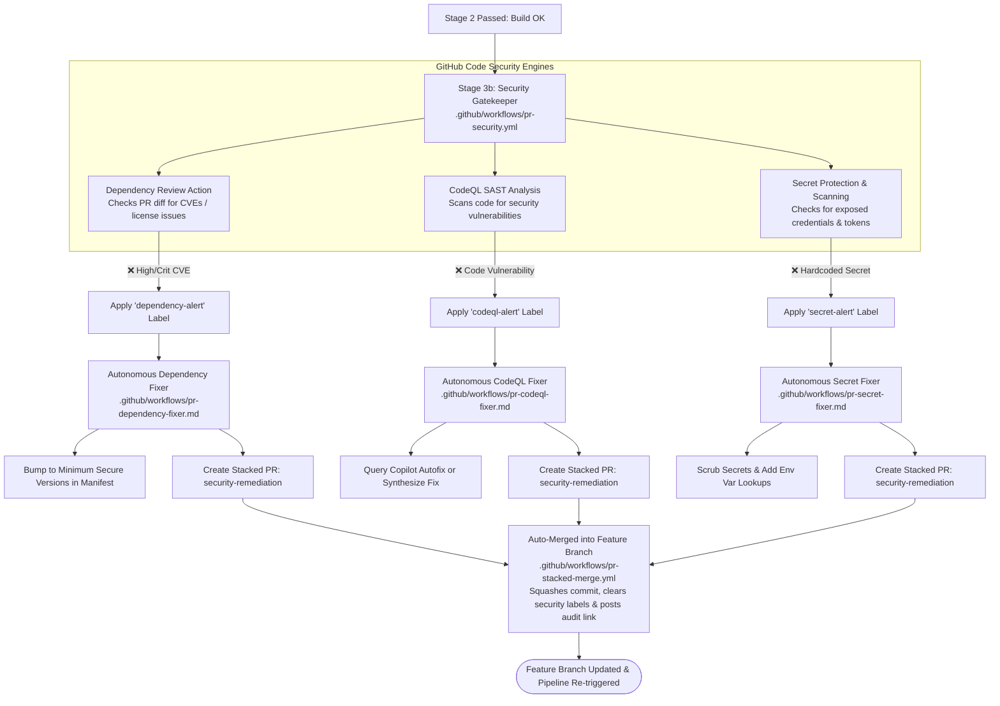
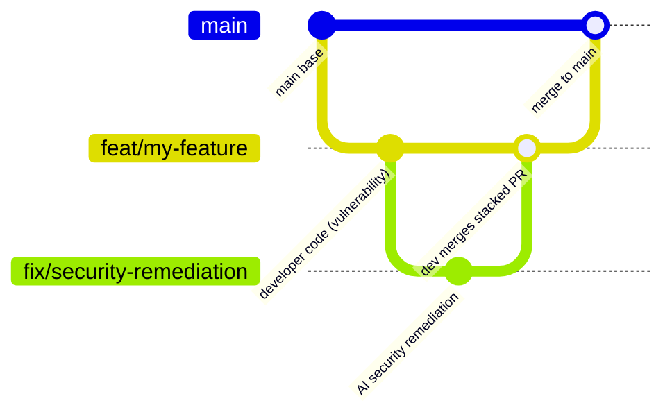

# Step 5: GitHub Code Security & Autonomous Remediation

This step implements security gates powered by **GitHub Code Security** combined with specialized, autonomous AI remediation loops for vulnerable dependencies, static code vulnerabilities, and exposed secrets.

---

## Architecture Overview


```

---

## 1. Deterministic Security Gate (`.github/workflows/pr-security.yml`)

The deterministic security gate leverages native GitHub Code Security features:

- **Dynamic Environment Detection**:
  - Automatically identifies whether the repository contains CodeQL-supported languages (`javascript-typescript`, `python`, `go`, `java-kotlin`, `csharp`, `ruby`, `c-cpp`, `swift`) and dependency manifests (`package.json`, `requirements.txt`, `go.mod`, `pom.xml`, `Cargo.lock`, etc.).
  - Skips jobs cleanly if no relevant source files exist, guaranteeing polyglot compatibility without false failures.
- **GitHub Dependency Review (`actions/dependency-review-action`)**:
  - Evaluates changes to dependency manifests introduced in the pull request against GitHub's Advisory Database.
  - Blocks high- and critical-severity CVEs from entering the codebase.
  - Applies the **`dependency-alert`** label on failure.
- **GitHub CodeQL SAST (`github/codeql-action`)**:
  - Automatically runs CodeQL with `autobuild` across detected languages.
  - Identifies security vulnerabilities like injection attacks, path traversal, and insecure cryptographic usage.
  - Applies the **`codeql-alert`** label on failure.
- **GitHub Secret Protection & Scanning**:
  - Repositories configure native GitHub Push Protection to reject hardcoded secrets server-side at `git push`.
  - The security gatekeeper inspects open secret alerts via GitHub's Secret Scanning API for web edits or bypassed secrets.
  - Applies the **`secret-alert`** label on failure.
- **Autonomous Label Management**:
  - Each label is independent: if only one check fails, only its specific alert label is attached.
  - When the developer merges the stacked PR, the security gate re-runs on their feature branch and automatically clears the labels.

---

## 2. Stacked PR Autonomous Remediation Loops

Rather than modifying the contributor's in-flight feature branch directly without consent, remediators propose their solutions as **Stacked Pull Requests**:



### 2a. PR Dependency Fixer (`.github/workflows/pr-dependency-fixer.md`)
- **Trigger**: Activates on the **`dependency-alert`** label.
- **Batched Remediation**: Reads Dependency Review failure logs and updates all vulnerable packages across manifests in a single stacked PR.
- **Itemized Commit-Style Structure**:
  - The PR body details each package bump with a distinct commit title (e.g. `fix(deps): bump <package> from <old> to <new> to resolve <CVE>`), CVE/GHSA advisory details, and version deltas.
  - Opens the stacked PR against the developer's feature branch and adds a notification comment on the parent PR.

### 2b. PR CodeQL Fixer (`.github/workflows/pr-codeql-fixer.md`)
- **Trigger**: Activates on the **`codeql-alert`** label.
- **Copilot Autofix Integration**:
  - Queries `gh api repos/{owner}/{repo}/code-scanning/alerts/<alert-number>/autofix` and PR review suggestions for an existing Copilot Autofix recommendation.
  - If a valid Copilot Autofix suggestion exists, it incorporates the patch into the remediation.
  - If Copilot Autofix is not enabled or produces no fix, the agent performs autonomous defensive refactoring using CodeQL taint analysis.
- **Itemized Commit-Style Structure**:
  - Remediates all open CodeQL alerts together in a single stacked PR.
  - The PR body documents each vulnerability resolved with a distinct commit title (e.g. `fix(security): sanitize input to prevent path traversal in <file>`), CWE number, sink, and defensive pattern.

### 2c. PR Secret Fixer (`.github/workflows/pr-secret-fixer.md`)
- **Trigger**: Activates on the **`secret-alert`** label.
- **Secret Scrubbing**:
  - Identifies exposed secrets from secret scanning alerts.
  - Scrubs hardcoded credentials from source files and replaces them with standard environment variable lookups (`process.env.SECRET_NAME`, `os.environ.get(...)`).
  - Adds dummy placeholder entries in `.env.example`.
- **Rotation Warning & Stacked PR**:
  - Opens a stacked PR targeting the author's feature branch with itemized commit titles for each scrubbed secret.
  - Posts a high-priority warning comment on the parent PR reminding the author to **immediately revoke and rotate the exposed credential** with the issuing provider.
