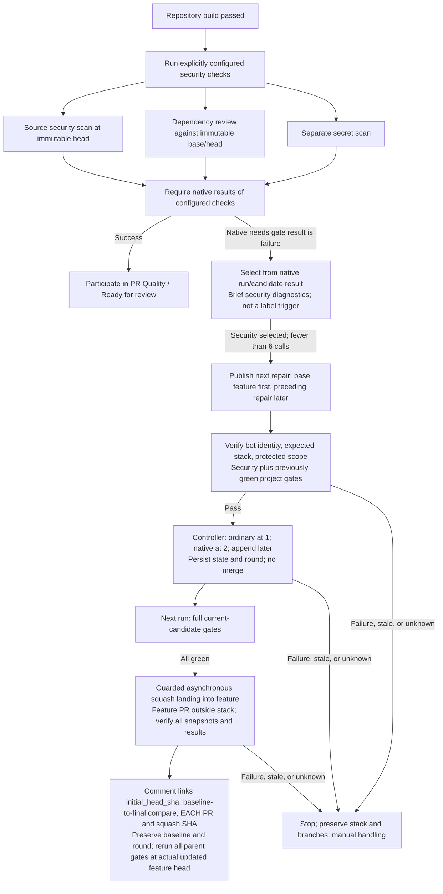

# Repository Security Checks and Native Repair

[`pr-security.yml`](../.github/workflows/pr-security.yml) is a reusable
`workflow_call` gate after build, alongside tests and documentation. The repository
explicitly configures its scanners and policies; the lifecycle does not discover
languages or generate a scanning matrix. It consumes native GitHub check
results and passes brief diagnostics to the repair planner.

## Explicit security responsibilities

The repository's scanner/check definitions are the source of truth for commands,
scan scope, policy thresholds, reports, and required permissions. The conceptual
roles are:

- **Source security scanning:** assess code at the immutable head using the
  configured scanner and its blocking policy.
- **Dependency review:** assess dependency changes against the captured base
  and head, applying the repository's vulnerability and other configured policies.
- **Secret scanning:** run an explicitly configured secret check independently
  of lint. Passing lint does not establish that secrets were checked.

These roles are not a promise that every language, dependency ecosystem, or
vulnerability class is covered. Adding or changing a scanner is an explicit
repository configuration decision, not an inference made by the lifecycle.
License or severity guarantees should be stated only when the corresponding
policy is actually enforced by the configured check.

## Checks enforce policy; the pipeline consumes results

Each scanner integration must translate blocking findings into a failing native
result. A scanner that completed execution may still have found vulnerabilities;
the configured integration, not the orchestration layer, enforces that policy.
Required-report validation also belongs to the scanner integration.

The lifecycle does not use universal report parsers, count alert-like log lines,
or treat a lack of diagnostic text as success. Brief findings are diagnostic
context only. Scanner, setup, permission, service, or dependency-review errors
must remain failures rather than being swallowed as an empty clean result.
Missing, skipped, or cancelled required checks cannot establish readiness.

Configure only the permissions and services required by the selected checks.
Repository-wide alert state is not automatically evidence about the current
PR revision. Changes to check policy and protected workflow files require
human review, not autonomous weakening of enforcement.

## Secrets and operational responsibility

The explicit secret scanner is separate from lint and from independently
configured repository push protection. This refactor does not enable repository
security settings automatically.

If a credential is exposed, a human must revoke and rotate it with the issuing
provider. Removing the value from current source does not invalidate it or
remove it from existing history. An automated code repair cannot complete that
external operational obligation.

## Scoped repair and fresh validation

Native `needs.<gate>.result == 'failure'`, not a failure label, makes security
eligible for repair. The single [`pr-repair.md`](../.github/workflows/pr-repair.md)
workflow, compiled to `pr-repair.lock.yml`, receives the selected security
findings through `workflow_call` after controller guards pass.
It may correct
insecure code, dependencies, or exposed values within the repository's allowed
repair scope, but cannot suppress findings or disable checks to obtain a pass.

The agent publishes only the next repair PR; native creation output supplies its
identity. The first repair targets feature and later repairs target the preceding
repair branch. The feature PR targets `main` outside the native stack, whose
trunk is feature. Validation verifies bot provenance, same-repository immutable
root/member snapshots, expected membership/order, and bounded/protected scope.

It reruns security and previously green project gates. Other inherited failures
or unexecuted gates remain unresolved, not certified regression-free. Scoped
success permits controller registration at two repairs or append of later
layers, **not immediate merge**. A single repair stays ordinary. Typed state
from a verified prior attempt of the same workflow records root snapshot,
ordered entries/check IDs, native stack number, consumed round, and the
cycle-start `initial_head_sha`, preserved through native landing.

The next run evaluates the full current candidate. Only all-green candidate
gates permit guarded asynchronous squash landing into feature, after pinning
the top and verifying every root/member snapshot, order, target, and applicable
rules. A single ordinary repair uses the same asynchronous API. Confirm every
repair's merged result and squash SHA, then comment on feature linking the
initial baseline, a SHA-pinned baseline-to-final comparison, each repair PR
and its per-layer squash SHA/revert target, and validation evidence. Those
references distinguish feature-original work from automated additions within
the combined feature diff. Full parent revalidation is still pending.

Feature-branch requirements may block intermediate layers; never weaken them.
Queues are blocked. Stale snapshots, conflicts, scope failures, API/poll failures,
or missing state stop explicitly for manual handling. Preserve stacks and
branches without unstack/recreate/rebase/force-push recovery.

Six repair calls total include metadata; landing does not reset the budget.
Bounded explicit dispatch validates each next exact candidate or feature head.
After landing, all parent gates rerun at the actual updated feature head.
Candidate results cannot certify the unmerged parent as
**`PR Quality / Ready for review`**; all six application quality gates and live
head/base/metadata must pass there. `pr-status.yml` adds `security-failed` and
source/dependency/secret labels from candidate failures, clearing each only from
passing actual current-parent component checks. Missing or skipped/cancelled
evidence retains unresolved labels. Labels never authorize actions, and `main`
still requires fresh human approval. See [native chaining](remediation-chaining.md).
