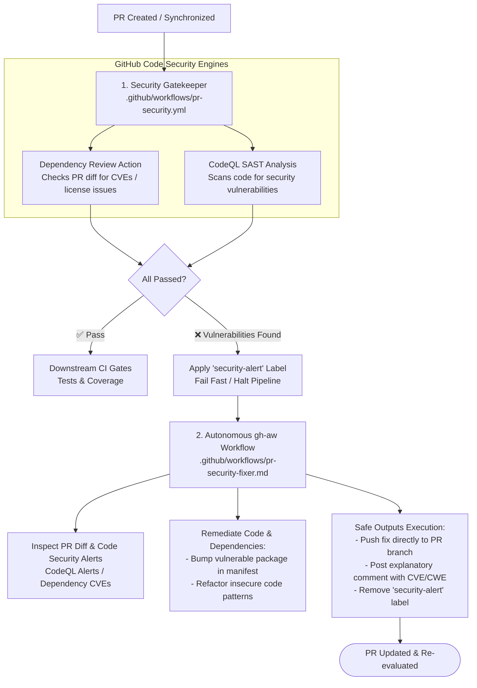

# Step 3: GitHub Code Security & Autonomous Remediation

This step implements security gates powered by **GitHub Code Security** combined with an autonomous AI remediation loop for vulnerabilities and insecure dependencies.

---

## Architecture Overview

---

## 1. Deterministic Security Gate (`.github/workflows/pr-security.yml`)

The deterministic security gate leverages native GitHub Code Security features:

- **Dynamic Environment Detection**:
  - Automatically identifies whether the repository contains CodeQL-supported languages (`javascript-typescript`, `python`, `go`, `java-kotlin`, `csharp`, `ruby`, `c-cpp`, `swift`) and dependency manifests (`package.json`, `requirements.txt`, `go.mod`, `pom.xml`, `Cargo.lock`, etc.).
  - Skips jobs cleanly if no relevant source files exist, guaranteeing polyglot compatibility without false failures.
- **GitHub Dependency Review (`actions/dependency-review-action`)**:
  - Evaluates changes to dependency manifests introduced in the pull request against GitHub's Advisory Database.
  - Blocks high- and critical-severity CVEs from entering the codebase.
- **GitHub CodeQL SAST (`github/codeql-action`)**:
  - Automatically runs CodeQL with `autobuild` across detected languages.
  - Identifies security vulnerabilities like injection attacks, path traversal, hardcoded secrets, and insecure cryptographic usage.
- **Autonomous Triggering**:
  - If any security vulnerability or vulnerable dependency is detected, marks the check as failed and applies the **`security-alert`** label.
  - When all security checks pass, clears the `security-alert` label.

---

## 2. Autonomous `gh-aw` Remediation Loop (`.github/workflows/pr-security-fixer.md`)

When a pull request introduces a vulnerability or vulnerable package, this GitHub Agentic Workflow investigates and remediates the alert.

- **Trigger**: Activates automatically when the **`security-alert`** label is added to a PR (or manually via `workflow_dispatch`).
- **Alert Investigation**:
  - Inspects the PR diff (`gh pr diff`).
  - Fetches CodeQL security alert details and Dependency Review run failure logs (`gh run view --log-failed`).
- **Remediation Strategy**:
  - **Dependencies**: Updates the package manifest to the minimum safe patched version recommended by the security advisory.
  - **Code Vulnerabilities**: Refactors code to eliminate the vulnerability (e.g., parameterized queries, input sanitization, safe standard library alternatives).
- **Safe Outputs Execution**:
  - `push-to-pull-request-branch`: Directly pushes the security fix commit to the PR branch.
  - `add-comment`: Adds a transparent comment detailing which CVE/CWE was remediated and how.
  - `remove-labels`: Removes `security-alert` so the gatekeeper can verify the fix.
