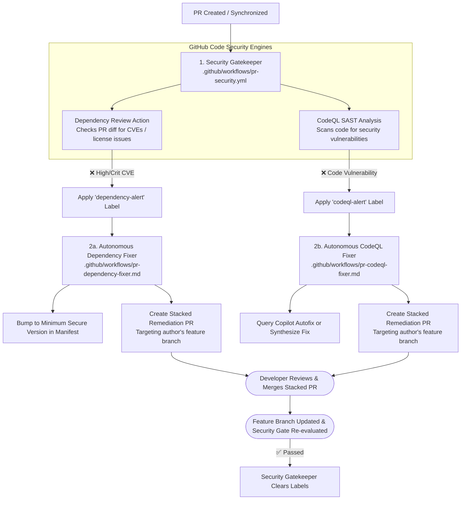
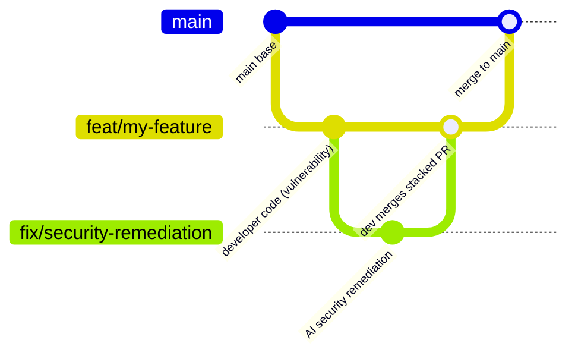

# Step 3: GitHub Code Security & Autonomous Remediation

This step implements security gates powered by **GitHub Code Security** combined with specialized, autonomous AI remediation loops for vulnerable dependencies and static code vulnerabilities.

---

## Architecture Overview

---

## 1. Deterministic Security Gate (`.github/workflows/pr-security.yml`)

The deterministic security gate leverages native GitHub Code Security features:

- **Dynamic Environment Detection**:
  - Automatically identifies whether the repository contains CodeQL-supported languages (`javascript-typescript`, `python`, `go`, `java-kotlin`, `csharp`, `ruby`, `c-cpp`, `swift`) and dependency manifests (`package.json`, `requirements.txt`, `go.mod`, `pom.xml`, `Cargo.lock`, etc.).
  - Skips jobs cleanly if no relevant source files exist, guaranteeing polyglot compatibility without false failures.
- **GitHub Dependency Review (`actions/dependency-review-action`)**:
  - Evaluates changes to dependency manifests introduced in the pull request against GitHub's Advisory Database.
  - Blocks high- and critical-severity CVEs from entering the codebase.
  - Applies the **`dependency-alert`** label on failure.
- **GitHub CodeQL SAST (`github/codeql-action`)**:
  - Automatically runs CodeQL with `autobuild` across detected languages.
  - Identifies security vulnerabilities like injection attacks, path traversal, hardcoded secrets, and insecure cryptographic usage.
  - Applies the **`codeql-alert`** label on failure.
- **Autonomous Label Management**:
  - Labels are managed independently: if only dependencies fail, only `dependency-alert` is applied.
  - When the developer merges the stacked PR, the security gate re-runs on their feature branch and automatically removes the label.

---

## 2. Stacked PR Autonomous Remediation Loops

Rather than modifying the contributor's in-flight feature branch directly without consent, both remediators propose their solutions as **Stacked Pull Requests**:

### 2a. PR Dependency Fixer (`.github/workflows/pr-dependency-fixer.md`)
- **Trigger**: Activates on the **`dependency-alert`** label.
- **Analysis**: Reads Dependency Review failure logs to identify the vulnerable package, version constraint, and CVE/GHSA advisory.
- **Remediation**: Updates the package manifest (e.g. `package.json`, `requirements.txt`, `go.mod`) to the minimum safe patched version.
- **Stacked PR Creation**:
  - Calls `create-pull-request` with `base` set to the developer's feature branch.
  - Labels the stacked PR with `security-remediation` and `human-review-needed`.
  - Comments on the parent PR directing the author to review and merge the stacked PR to clear the gate.

### 2b. PR CodeQL Fixer (`.github/workflows/pr-codeql-fixer.md`)
- **Trigger**: Activates on the **`codeql-alert`** label.
- **GitHub Copilot Autofix Integration**:
  - Queries `gh api repos/{owner}/{repo}/code-scanning/alerts/<alert-number>/autofix` and PR review suggestions for an existing Copilot Autofix recommendation.
  - If a valid Copilot Autofix suggestion exists, it incorporates the patch into the remediation branch.
  - If Copilot Autofix is not enabled or produces no fix, the agent performs autonomous defensive refactoring (parameterizing queries, adding path sanitization, validating input) using CodeQL taint analysis.
- **Stacked PR Creation**:
  - Opens a stacked PR targeting the developer's feature branch containing the defensive fix.
  - Comments on the parent PR with an explanation of the CWE/vulnerability resolved and instructions to merge.
