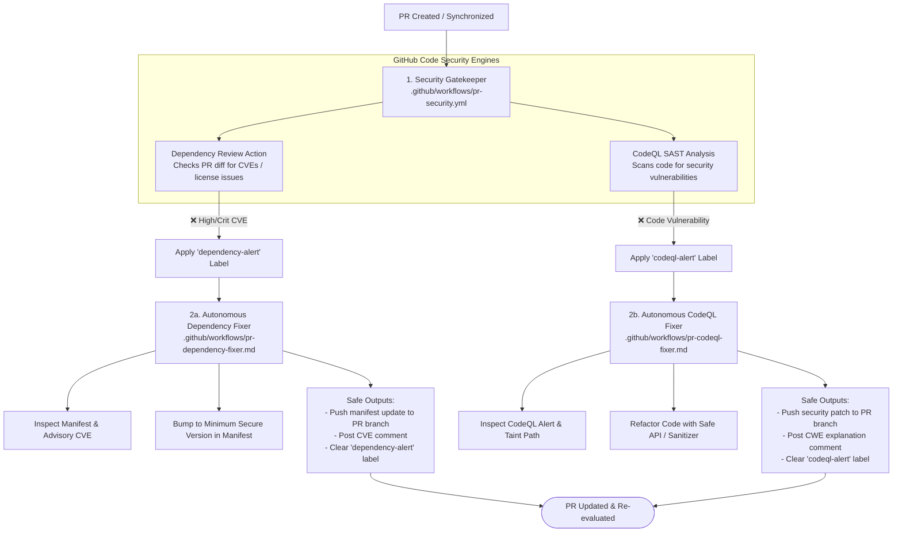

# Step 3: GitHub Code Security & Autonomous Remediation

This step implements security gates powered by **GitHub Code Security** combined with specialized, autonomous AI remediation loops for vulnerable dependencies and static code vulnerabilities.

---

## Architecture Overview

---

## 1. Deterministic Security Gate (`.github/workflows/pr-security.yml`)

The deterministic security gate leverages native GitHub Code Security features:

- **Dynamic Environment Detection**:
  - Automatically identifies whether the repository contains CodeQL-supported languages (`javascript-typescript`, `python`, `go`, `java-kotlin`, `csharp`, `ruby`, `c-cpp`, `swift`) and dependency manifests (`package.json`, `requirements.txt`, `go.mod`, `pom.xml`, `Cargo.lock`, etc.).
  - Skips jobs cleanly if no relevant source files exist, guaranteeing polyglot compatibility without false failures.
- **GitHub Dependency Review (`actions/dependency-review-action`)**:
  - Evaluates changes to dependency manifests introduced in the pull request against GitHub's Advisory Database.
  - Blocks high- and critical-severity CVEs from entering the codebase.
  - Applies the **`dependency-alert`** label on failure.
- **GitHub CodeQL SAST (`github/codeql-action`)**:
  - Automatically runs CodeQL with `autobuild` across detected languages.
  - Identifies security vulnerabilities like injection attacks, path traversal, hardcoded secrets, and insecure cryptographic usage.
  - Applies the **`codeql-alert`** label on failure.
- **Autonomous Label Management**:
  - Labels are managed independently: if only dependencies fail, only `dependency-alert` is applied.
  - When checks pass, their respective label is automatically removed.

---

## 2. Autonomous Remediation Loops

### 2a. PR Dependency Fixer (`.github/workflows/pr-dependency-fixer.md`)
- **Trigger**: Activates on the **`dependency-alert`** label.
- **Analysis**: Reads Dependency Review failure logs to identify the vulnerable package, version constraint, and CVE/GHSA advisory.
- **Remediation**: Updates the package manifest (e.g. `package.json`, `requirements.txt`, `go.mod`) to the minimum safe patched version.
- **Safe Outputs**: Commits and pushes the manifest patch to the PR branch, comments with the CVE breakdown, and clears `dependency-alert`.

### 2b. PR CodeQL Fixer (`.github/workflows/pr-codeql-fixer.md`)
- **Trigger**: Activates on the **`codeql-alert`** label.
- **Analysis**: Inspects CodeQL alerts and source sink/taint paths via GitHub code scanning alerts and run logs.
- **Remediation**: Refactors the code defensively (parameterizing queries, adding path sanitization, validating input) while preserving business logic.
- **Safe Outputs**: Pushes the code patch to the PR branch, comments explaining the CWE remediation, and clears `codeql-alert`.
