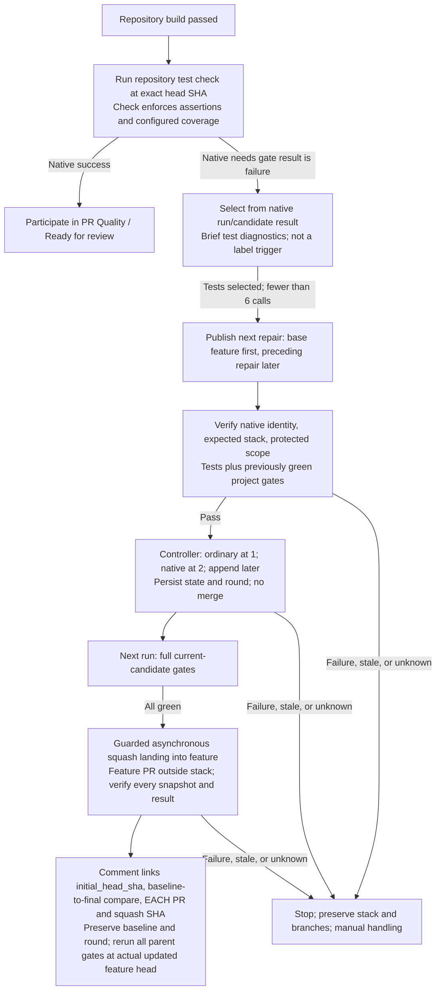

# Repository Tests, Coverage, and Native Repair

[`pr-test.yml`](../.github/workflows/pr-test.yml) runs through `workflow_call`
after build, in parallel with security and documentation. Its thin adapter
executes the repository's fixed test/check script at the captured head SHA.
The repository check owns testing and coverage enforcement; the lifecycle
consumes its native GitHub result.

## The repository defines the test contract

The repository's check definitions and configuration are the source of truth
for the runner, test selection, environment, coverage instrumentation, measured
scope, metric, and required threshold. The lifecycle does not auto-detect a
language, choose a test framework, install guessed coverage packages, or parse
every framework's reports through a universal coverage adapter.

The configured check must return failure when assertions fail or its coverage
policy is unmet. A high coverage result does not excuse failing tests, and
passing assertions do not excuse insufficient coverage. Required evidence,
missing-test behavior, and report validation belong to that check's explicit
configuration, not to text heuristics in the orchestrator.

There is no universal coverage percentage or promise of diff-scoped measurement.
Describe only what the repository check actually measures and enforces.
Selecting changed tests alone does not establish changed-line coverage.

The adapter preserves setup/command failures. It does not retry with a weaker
command after a test or coverage failure. A missing configured check must not
be treated as successful verification.

## Native result versus diagnostics

The native job conclusion is authoritative for orchestration. Brief log excerpts
and findings provide context for the author or repair agent; they are not a
second test runner or coverage verdict. Truncation, missing phrases, or an empty
excerpt cannot turn a failed check green.

Test and coverage reports remain useful evidence for human inspection according
to the repository's reporting configuration. The lifecycle does not claim
additional coverage enforcement merely because a report was produced.

## One repair workflow

The pipeline selects from native `needs.<gate>.result == 'failure'`, not labels.
When tests are selected and controller guards pass, it sends findings through
`workflow_call` to
[`pr-repair.md`](../.github/workflows/pr-repair.md), compiled to
`pr-repair.lock.yml`. The agent can correct production behavior or tests within
the repository's allowed repair scope. It must preserve meaningful assertions
and must not delete failing tests, lower thresholds, or weaken check
configuration to manufacture success.

The agent publishes only the next repair PR. The first targets the feature
branch; later layers target the preceding repair branch. Native creation output,
not labels or a guessed branch, identifies it. The feature PR targets `main`
outside the stack; feature is the trunk. Validation checks bot provenance,
same-repository immutable root/member identities, expected stack order and
membership, and bounded/protected scope.

The scoped check reruns tests and previously green project gates.
Inherited red or unexecuted gates remain unresolved, not certified regression-free.
Scoped success permits controller registration at two repairs or append of later
layers, never immediate merge. A single repair stays ordinary. Typed state from
a verified prior attempt of the same workflow carries the root snapshot, ordered
repair entries/check IDs, native stack number, consumed round, and
`initial_head_sha` captured at bounded-cycle start and preserved through landing.

The next run checks the full current candidate. Only when all its gates are
green may the controller pin the top, verify all root/member snapshots, order,
target, and rules, and request guarded asynchronous squash landing into feature.
The single ordinary repair uses the same asynchronous path. Confirm each merged
member and squash SHA. The feature comment links the initial baseline,
baseline-to-final SHA comparison, and each repair PR and per-layer squash
SHA/revert target, distinguishing the feature-original snapshot from automated
additions in the combined diff. Bounded explicit dispatch then reruns all parent
gates at the actual updated feature head.

Candidate checks cannot certify an unmerged feature PR as
**`PR Quality / Ready for review`**. Feature-branch rules can block intermediate
layers and must never be weakened; queues are blocked. Changed snapshots,
conflicts, scope failures, API/poll failures, or missing state stop for manual
handling, preserving stacks/branches without unstack/recreate/rebase/force-push.

At most six repair calls total, including metadata, are allowed per cycle;
landing never resets the budget. `pr-status.yml` adds `test-required` from
candidate failures and clears it only from passing actual current-parent checks.
Skipped/cancelled or missing evidence retains unresolved status.
Labels never authorize repair or merge. See
[native chaining](remediation-chaining.md) and
[fresh human approval before main](pr-review-and-consolidation.md).
