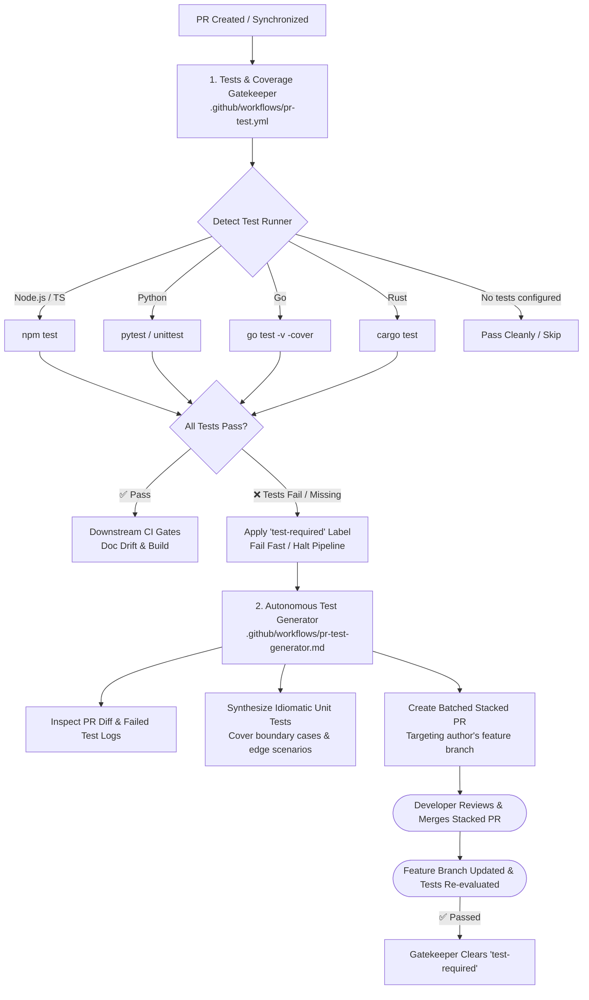

# Step 4: Polyglot Automated Testing & Autonomous Test Generation

This step implements automated testing and coverage validation combined with an autonomous AI remediation loop that drafts missing unit tests and fixes broken assertions.

---

## Architecture Overview

---

## 1. Deterministic Testing Gate (`.github/workflows/pr-test.yml`)

The deterministic test runner automatically discovers and executes test suites based on repository manifests:

- **Universal & Polyglot**:
  - **JavaScript / TypeScript**: Discovers `package.json` test scripts (`npm test`).
  - **Python**: Discovers `pytest` / `unittest` test suites (`test_*.py`).
  - **Go**: Discovers `go.mod` and executes `go test -v -cover ./...`.
  - **Rust**: Discovers `Cargo.toml` and runs `cargo test`.
  - **Zero Noise**: Repositories without test suites or manifests skip cleanly without failing the check.
- **Fail-Fast & Triggering Remediation**:
  - If test assertions fail or errors are thrown, the gatekeeper fails and attaches the **`test-required`** label.
  - When tests pass, the `test-required` label is automatically cleared.

---

## 2. Autonomous Test Generator (`.github/workflows/pr-test-generator.md`)

When unit tests fail or code changes lack test coverage, this GitHub Agentic Workflow drafts idiomatic unit tests.

- **Trigger**: Activates automatically when the **`test-required`** label is added to a PR.
- **Diff & Failure Analysis**:
  - Identifies uncovered functions, error handling branches, and boundary edge cases in the PR diff.
  - Inspects failed test logs (`gh run view <run-id> --log-failed`) to pinpoint broken assertions.
- **Stacked PR Remediation**:
  - Writes comprehensive unit tests matching existing project conventions and frameworks.
  - Opens a **Stacked Pull Request** targeting the author's feature branch with clear documentation of the test scenarios covered.
  - Posts a notification comment on the parent PR directing the developer to review and merge the tests.
