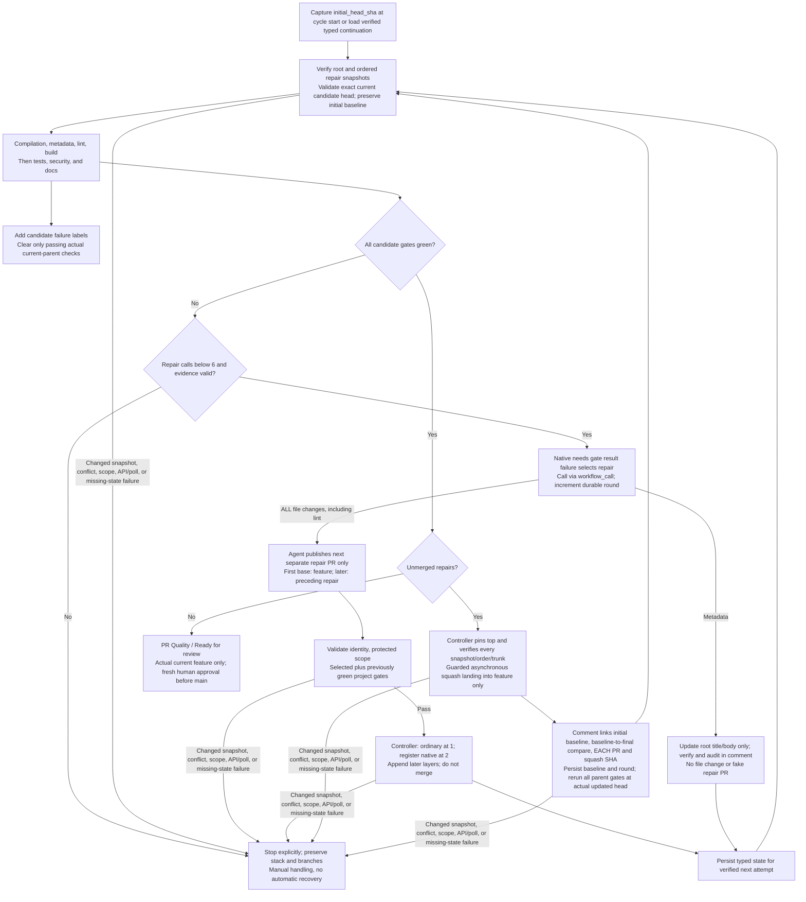

# Native PR Validation and Repair-Only Stacks

The lifecycle is language-neutral. Repository-owned checks define validation;
native GitHub results drive ordering, scoped repair, candidate revalidation, and
human review. One gh-aw repair workflow handles one selected failing gate per
call. This guide describes the intended controller contract, not deployed
repository settings or proof of runtime enforcement.

**The feature PR targets `main` and stays outside the native stack.** Its feature
branch is the repair stack's **trunk**. The first repair targets that feature
branch; each later repair targets the preceding repair branch. The controller
registers a real GitHub-native stack once two scoped repairs pass validation,
then appends later validated layers. Scoped success never immediately merges a
repair.

```text
feature -> main                 feature PR: outside the native stack
repair-1 -> feature             bottom repair: trunk is feature
repair-2 -> repair-1            second repair
repair-3 -> repair-2            top repair: complete current candidate
```

A single repair remains an ordinary PR because native stacks require at least
two PRs. It still follows the same candidate checks and guarded asynchronous
landing protocol. Metadata-only repairs update the feature PR's title/body
without code pushes or an empty repair PR.

## Entry points and immutable validation

[`pr-start.yml`](../.github/workflows/pr-start.yml) bootstraps supported
same-repository feature-PR events and dispatches
[`pr-pipeline.yml`](../.github/workflows/pr-pipeline.yml). The pipeline validates
its dispatch ref and `github.sha` against the captured validation target.
Initially that target is the feature head; while repairs are pending it is the
top repair head. Every run also verifies the root feature PR snapshot.

The root snapshot includes PR/repository identity, head/base branch names and
SHAs, and the title/body hash. Candidate validation additionally captures all
ordered repair identities and immediate base/head snapshots. A stale run cannot
certify another revision.

At bounded-cycle start, capture **`initial_head_sha`**, the feature head before
this cycle's automated repairs. Preserve it in every continuation, including
after native landing advances the current root head. It is the cycle's
feature-original baseline, not a mutable reference or a claim that all earlier
commits were human-authored. It does not replace the root base used to validate
the complete feature change.

An initial run starts at round `0` only when no existing repair continuation
needs reconciliation. Automatic continuations must supply verified state;
omitting it or claiming round `0` cannot reset the budget or adopt open repairs.
Unrecognized existing bot repairs block publication of duplicates. A PR-list
search can detect blockers, but cannot establish ownership or continuation.



## Repository-owned checks

Metadata precedes app lint and build. After build succeeds, app tests, security,
and documentation run in parallel. Framework CI runs independently: it compiles
only framework input changes and runs framework regressions when needed.
Its separate `Framework CI / Required` result blocks merging when unsuccessful,
but is not a prerequisite for app checks or an automatic repair target.

Lint, build, and test are thin adapters to fixed repository checks. Security
uses explicit source, dependency, and separate secret checks. Repository
configuration owns tooling, scope, thresholds, reports, and pass/fail behavior.
There is no language auto-detection, generated scanner matrix, or universal
coverage parser. Brief logs and `findings` are diagnostics, not verdicts or
continuation state.

The documentation reviewer is always called when its deep-check stage runs,
without extension/directory eligibility filters. It judges the complete feature
change, including all candidate layers, against the captured root base.
Its version-2 decision artifact maps `not_needed` or `sufficient` to pass and
`missing` or `uncertain` to fail. See the
[documentation contract](pr-docs-and-updater.md#implemented-evaluator-and-artifact-contract).
Only a validated `missing` decision authorizes a docs repair. Uncertain
assessments, authentication failures and missing evidence fail without launching
an app documentation patch.

| Gate                 | Workflow                            | Repair responsibility                                               |
| :------------------- | :---------------------------------- | :------------------------------------------------------------------ |
| Metadata             | `pr-gatekeeper.yml`                 | Root title/body; invalid branch naming may require its author.      |
| Lint                 | `pr-lint.yml`                       | One scoped lint repair PR.                                          |
| Build                | `pr-build.yml`                      | One scoped build repair PR.                                         |
| Tests                | `pr-test.yml`                       | One scoped repair for test or repository-enforced coverage failure. |
| Security             | `pr-security.yml`                   | One scoped repair for configured security findings.                 |
| Documentation        | `pr-docs.yml`                       | One scoped documentation repair PR.                                 |

Full candidate validation runs all six application gates through their normal
dependencies. Metadata is the root feature PR's metadata; code checks use the
complete current candidate head, not just the new layer's patch. Skipped,
cancelled, missing, or failed required evidence cannot establish an all-green
candidate. Candidate success authorizes consideration of landing only: it
**cannot certify the unmerged feature PR as Ready for review**.

## What triggers a repair, and why not labels?

The controller inspects native **`needs.<gate>.result`** values in
`pr-pipeline.yml`. A repairable gate with result **`failure`** selects a repair;
after identity, state, and budget guards pass, the pipeline calls
`pr-repair.lock.yml` through **`workflow_call`** in that run. For example,
`needs.lint.result == 'failure'` makes lint eligible for selection. With several
failures, the controller selects one gate, not one agent per label.
Skipped, cancelled, or missing results do not invent a failure diagnosis or a
successful check.

After scoped publication/registration, a verified metadata update, or confirmed
landing, **bounded explicit dispatch** starts validation of the next exact
candidate or updated feature revision. The native results retain their workflow
run/attempt and candidate identity, with check IDs and captured SHAs in verified
state. Brief gate findings explain the selected failure but do not replace the
native result.

Labels are only a human-readable view of those results:

- `GITHUB_TOKEN`-created label events generally do **not** start new workflow
  runs. Explicit `workflow_dispatch` and `repository_dispatch` are exceptions
  to token event suppression; this design uses explicit dispatch, not a label
  event, for continuation.
- Labels are mutable, not SHA-bound, and contain neither diagnostic evidence
  nor the authoritative run/candidate identity.
- A label-triggered alternative would need extra credentials or a separately
  supported event exception, plus deduplication, stale-event checks, and loop
  prevention. None of that makes the label a validation verdict.

GitHub documents these rules and the distinct approval-required PR-event
exceptions in
[Triggering a workflow](https://docs.github.com/en/actions/how-tos/write-workflows/choose-when-workflows-run/trigger-a-workflow).
Adding, removing, or re-adding a failure label never starts or approves a repair
in this lifecycle.

## One selected gate per repair call

[`pr-repair.md`](../.github/workflows/pr-repair.md), compiled to
`pr-repair.lock.yml`, receives the selected `repair_kind`, its findings, and
the captured publication context. Other failed or unexecuted gates remain
unresolved; this is not a combined multi-gate repair request.

**Every automated file change, including lint/formatting fixes, must be published
in a separate repair PR**, never pushed directly into the feature branch or
folded into its original commits. This covers code, tests, documentation,
dependency changes, and any allowed generated-file updates. No file-writing
repair has a direct-push exception; protected workflow/policy changes remain
human-only rather than becoming an automated exception.

For file repairs, the agent publishes **only the next repair PR**. Native creation
output supplies its authoritative identity; titles, labels, branch-name guesses,
arbitrary PR links, and agent decisions do not. The repair is nonempty and based
on the exact feature head for the first layer or exact preceding repair head
for later layers. Before each publication, recheck the root and all existing
member snapshots and reject unrecognized bot repairs rather than duplicate them.
It must not weaken tests, coverage, check scripts, or protected
workflow policy. The agent cannot register native stack metadata, merge, rebase,
or push code into the feature branch.

For metadata, native `update-pull-request` changes only the root title/body.
Continuation requires successful publication, an actual metadata hash change,
and unchanged root code/base and member snapshots. The controller records this
verified metadata transition and reruns full validation of the current candidate.
It also writes an explicit feature-PR audit comment identifying the title/body
update, the validation run, and unchanged code head/`initial_head_sha`; the comment
states that no files changed and revalidation is pending. No empty PR or stack
member is created, but the call still consumes budget.

## Scoped validation and native registration

[`pr-validate-repair.yml`](../.github/workflows/pr-validate-repair.yml) must verify:

- Native creation identity and bot provenance.
- Open same-repository root and repair PRs with exact head/base identities.
- First-layer ancestry from the captured feature head; later-layer ancestry from
  the captured preceding repair head.
- The feature PR remains outside the stack, the stack trunk is the feature
  branch, and membership/order matches verified state exactly. Unknown or
  unexpected membership blocks progress.
- A nonempty, bounded patch within allowed scope, guarding protected paths and
  quality policy.

The validator runs the **selected gate plus previously green project gates**
against the new repair head. Lint, build, test, security, and documentation form
the project-gate set; required extra checks for allowed changes still apply.
Each required scoped check must succeed, and its immutable native check identity
is recorded. Previously red or unexecuted gates remain unresolved, **not
certified regression-free**.

The native **`Scoped repair validation`** check records this limited result on
the repair head. Missing, skipped, cancelled, or failed required evidence stops
progress. The validator does not merge.

The planned controller module **`pr-register-repair-stack.yml`** consumes the
verified identity and scoped check evidence:

1. Keep the first validated repair ordinary; GitHub's native minimum is two PRs.
2. At the second validated repair, create native stack metadata containing
   exactly those two repairs, ordered bottom-to-top, with the feature branch as
   trunk.
3. For later validated repairs, append exactly the new layer to that verified
   stack, retaining its stack number.
4. Read back and verify all membership, ordering, snapshots, and trunk, then
   persist state and dispatch full validation of the new top candidate.

Registration is not landing. Any registration/readback error stops explicitly
without dissolving, recreating, or "repairing" the stack.

## Typed continuation, not inferred history

Continuation is a small, schema-validated state artifact produced by the
controller from a **verified prior attempt of the same workflow**. The consumer
checks the artifact's repository/workflow/run/attempt provenance and every live
identity before using it. Missing, malformed, stale, mismatched, or unavailable
state stops automation; there is no reconstruction from logs or PR listings.

The conceptual state contains:

| State                  | Required meaning                                                                                                                                                                      |
| :--------------------- | :------------------------------------------------------------------------------------------------------------------------------------------------------------------------------------ |
| Root snapshot          | Feature PR/repository identity, head/base refs and SHAs, title/body hash.                                                                                                             |
| `initial_head_sha`     | Feature head captured at bounded-cycle start; immutable origin baseline, preserved when landing updates the current root head.                                                        |
| Ordered repair entries | Authoritative PR identities; immediate base/head snapshots; selected gate; scoped and full-candidate native check/run IDs and recorded conclusions, including previously green gates. |
| Native stack number    | Verified stack identity, absent only when no stack exists or the single repair remains ordinary.                                                                                      |
| Round                  | Durable count of repair calls already consumed, from `0` through `6`.                                                                                                                 |
| Verified transitions   | Metadata updates or confirmed landing results needed to explain a new root snapshot and preserve audit history and budget.                                                            |

The state is a controller record, not an agent-authored decision. Native checks
remain authoritative; stored conclusions must match their immutable check IDs.
The documentation assessment artifact carries a separate semantic decision and
is not repair-continuation state.

After a confirmed landing the controller records the merged entries and squash
SHAs, advances the expected root head to the verified actual result, and marks
that batch landed. It does not forget the round or silently reuse old candidate
checks as parent evidence. **`initial_head_sha` never advances with the root
snapshot.** Any later repair batch uses the remaining budget and the same initial
baseline.

## Guarded asynchronous landing and audit trail

Only an all-green full current candidate can reach the planned controller module
**`pr-land-repair-stack.yml`**. Before submitting, it pins the exact top head and
rechecks:

- The root PR's entire captured snapshot and absence from native stack membership.
- Every member's PR/repository identity, state, head/base refs and SHAs,
  provenance, scoped check evidence, and the full current-candidate checks.
- Exact bottom-to-top order, stack number, complete membership, and feature
  trunk/target; no extra member or path to `main`.
- Fresh mergeability and applicable branch rules; merge queues are unsupported
  and explicitly blocked, never bypassed.

For two or more repairs, request **squash merging the top PR through GitHub's
native asynchronous merge API**. This lands the entire repair-only group
atomically in ascending order into the feature branch, producing each repair's
own squash commit. A single ordinary repair uses the **same guarded asynchronous
API**, not the legacy synchronous merge endpoint.

Submission is not success: branch rules are evaluated during execution. Poll
within a bounded wait, require confirmed success, and verify every member's
merged result and squash SHA plus the actual feature head and expected landing
history. The root identity, base, and metadata must remain unchanged; only the
verified landing may advance its head. API errors, polling errors/timeouts,
unknown outcomes, or unverifiable
results stop explicitly. Never fall back to individual legacy merges or queue
bypass.

The feature PR receives an audit comment distinguishing the **feature-original
baseline** from **automated additions**. It links:

- The immutable baseline commit **`initial_head_sha`** captured at cycle start.
- A SHA-pinned **baseline-to-final comparison**, from `initial_head_sha` to the
  actual feature head after confirmed landing, showing this cycle's file changes.
- **Each repair PR and its own confirmed per-layer squash SHA/revert target**,
  with the selected repair gate, scoped evidence, and full candidate run.

The feature PR's combined diff against `main` will include the merged repairs;
it cannot keep those additions visually separate by itself. The original
baseline, compare link, focused repair PRs, and per-layer commits distinguish
origin. Later landings retain that original baseline and add their audit links;
they do not relabel earlier repairs as original feature work.

The comment states that full parent revalidation and human review are still
pending. Preserve all branches. A new full pipeline must rerun all application
gates against the **actual updated feature head**. The controller also dispatches
independent framework CI on that head because token-generated events do not
reliably start it. Candidate checks and landing success do not replace these runs.

## Six-call budget and explicit stops

- A cycle allows **at most six repair calls total**, including metadata-only
  calls. Each selects one failing gate.
- Count the call when it is authorized, not only when a repair succeeds. No-op
  publication, agent failure, or rejected scope is not a free extra call.
- Round `6` still permits validation and guarded landing of an already green
  candidate, but never a seventh repair call.
- Registration, candidate validation, landing, and post-landing parent validation
  do not reset the round. Bot events cannot start a fresh budget.
- An owned pending stack is continued only from verified state. Unknown existing
  bot repairs block duplicate publication; arbitrary PR-list adoption is forbidden.
- Changed snapshots, conflicts, scope/policy failures,
  cancelled or missing evidence, registration/merge API errors, polling failures,
  and missing continuation state stop explicitly.
- Preserve existing stacks and branches on every error, including a human edit
  or a partial external merge. Do not unstack, recreate, rebase, force-push, or
  automatically recover a changed snapshot. Humans must reconcile the work
  before deliberately starting a new cycle; a blind round-`0` retry is not recovery.

Native stack rules derive from the bottom PR's base, here the **feature branch**,
and are enforced on every member. Feature-branch requirements can therefore
block intermediate layers even when the full candidate is green. Stop rather
than weakening rules, waiving checks, bypassing review, or merging layers by
another route.

## Actual-parent readiness and visible labels

**`PR Quality / Ready for review`** requires successful immutable root context,
and all six application quality gates on the actual current feature revision,
with matching live head/base/metadata and no pending unmerged repairs. Only this
fresh parent result proceeds to [human review](pr-review-and-consolidation.md).
Merging the feature PR into `main` remains outside repair landing and requires
fresh human/code-owner approval and both required application and framework checks.

[`pr-status.yml`](../.github/workflows/pr-status.yml) mirrors native results:

| Result category    | Visible label                 |
| :----------------- | :---------------------------- |
| Metadata           | `needs-metadata`              |
| Lint               | `lint-failed`                 |
| Build              | `build-failed`                |
| Tests/coverage     | `test-required`               |
| Documentation      | `docs-required`               |
| Security aggregate | `security-failed`             |
| Source scan        | `codeql-alert`                |
| Dependency review  | `dependency-alert`            |
| Secret scan        | `secret-alert`                |

Candidate failures add the matching labels on the feature PR. Clear a label
**only from a passing check on the actual current parent snapshot**, never from
candidate/scoped success or a landing result. Skipped, cancelled, unexecuted,
missing component output, or stale evidence retains unresolved status.
Labels never trigger or authorize repair, merging, or check waivers; manual
removal changes visibility only.

Framework status is shown by its native required check, not by app labels.
The legacy `workflow-compilation-failed` label is retired; remove an existing
instance during rollout after independently verifying framework CI.

## Operational boundaries and sources

The runtime design uses repository `GITHUB_TOKEN`; administrator-configured
permissions and branch rules remain prerequisites. Explicit dispatch connects
validation attempts, and `workflow_call` connects jobs within a run. Token-created
events are not a continuation mechanism. An awaiting-approval run is not a
completed check. The controller never grants itself bypass or weakens branch
rules; unsupported merge-queue policies stop both repair landing and optional
final auto-merge.

GitHub's official documentation establishes the platform contract:

- [About stacked pull requests](https://docs.github.com/en/pull-requests/get-started/about-stacked-prs):
  at least two same-repository PRs, the bottom may target **any branch**, and
  requirements follow that trunk across members.
- [Stacked pull requests APIs and webhooks](https://docs.github.com/en/pull-requests/reference/stacked-pull-requests-apis-and-webhooks):
  REST stack management, read-only GraphQL membership, mandatory asynchronous
  stack merging, atomic group merge, and rules evaluated during execution.

GitHub supports partial stack merges, rebasing, and merge queues generally; this
controller intentionally does **not** use those recovery or queue paths.
See [compiler verification](agentic-workflows-compilation.md) and
[repository prerequisites](../prereqs.md). These guides neither change settings
nor claim the planned modules are deployed.
