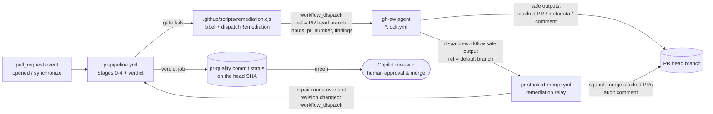

# Remediation Chaining Without Personal Access Tokens

The whole PR lifecycle runs on the repository's default `GITHUB_TOKEN`. GitHub deliberately
does **not** start new workflow runs for events created with that token — labels, pushes,
pull requests, and even `workflow_run` completions of runs that were dispatched with it.
The only events it may create are `workflow_dispatch` and `repository_dispatch`.

The framework therefore chains every hop explicitly with `workflow_dispatch`:



## Check → Repair → Recheck → Review & merge

1. **Check** — `pr-pipeline.yml` runs every gate once per PR *revision*: the head SHA plus a hash of
   the PR title, body and gate decision labels (`docs-not-required`). Stage 0 sets the `pr-quality`
   commit status to `pending`; the **PR Quality Verdict** job sets it to `success` only when every
   gate passed, otherwise `failure` with the failing / not-run gates. A revision that already has a
   final verdict is not checked again (re-check it with `-f force=true` or *Re-run all jobs*).
2. **Repair** — a failing gate labels the PR and dispatches its agent with the concrete findings,
   at most `MAX_REMEDIATION_ATTEMPTS` (default `2`) times per agent and PR branch.
3. **Recheck** — each agent hands off to the relay, which merges stacked PRs and then waits until
   the *repair round* is over: no other agent on the branch has yet to apply its safe outputs and
   no pipeline run is in progress. Only then, and only if the revision has no verdict yet, it
   re-dispatches the pipeline — so one round of N agents costs one recheck, not N. If the round
   changed nothing, it stops and asks for a human instead of looping. Agents never remove gate
   labels or set the status: an agent reporting "fixed" is never a substitute for a passing gate.
4. **Review & merge** — automation stops here. Only stacked remediation PRs are merged
   automatically (into the feature branch); the feature PR itself is never auto-merged. Once
   `pr-quality` is green, Stage 4 requests a Copilot review and a human gives the final approval
   and merges.

## Building blocks

| Piece | Responsibility |
| :--- | :--- |
| `pr-pipeline.yml` | Runs on `pull_request` **and** `workflow_dispatch(pr_number, force)`. Stage 0 resolves the PR (number, head/base ref, head SHA, revision), de-duplicates already-checked revisions, sets `pr-quality` to `pending`; the verdict job publishes the final `pr-quality` status. New pushes cancel a running check; relay dispatches queue behind it. |
| `.github/scripts/remediation.cjs` | Shared helper used by every gate: adds/removes labels and dispatches the matching agent on the PR head branch. It skips dispatch when the agent is already running, when an unmerged stacked remediation PR exists, or when the retry budget is exhausted (then it comments once asking for a human). |
| `.github/scripts/pr-quality.cjs` | Revision fingerprint, `pr-quality` status read/write, and detection of agents that are still part of the current repair round. |
| Reusable gates | Called by the pipeline via `workflow_call`. Each also has a `workflow_dispatch` that takes only `pr_number`; head/base refs and head SHA are resolved from the PR, and the run fails if it was not dispatched on the PR head branch. They do not declare workflow-level concurrency. Gates are the only writers of their labels. |
| gh-aw agents (`pr-*.md`) | Triggered only by `workflow_dispatch` with `pr_number` and `findings` inputs (the gate's concrete failure output — linter messages, failing tests and coverage, CodeQL rule/file/line). Safe outputs target the PR explicitly and cannot remove gate labels. They are purely declarative — a natural-language prompt plus gh-aw frontmatter (no `steps:`/`jobs:` scripts) — and hand off to the relay with the `dispatch-workflow` safe output as their last action. |
| `pr-stacked-merge.yml` | The relay. Marks draft stacked PRs ready, squash-merges every open `*-remediation` PR into the parent branch, posts an audit comment, waits for the repair round to end, and re-dispatches the pipeline once if the revision changed. |

## Gate → agent mapping

| Gate (stage) | Label | Agent | Fix delivery |
| :--- | :--- | :--- | :--- |
| Pre-Flight Gatekeeper (1a) | `needs-metadata` | `pr-validation.lock.yml` | Edits PR title/body |
| Linters (1b) | `lint-failed` | `pr-lint-fixer.lock.yml` | Stacked PR (`lint-remediation`) |
| Tests & Coverage (3a) | `test-required` | `pr-test-generator.lock.yml` | Stacked PR (`test-remediation`) |
| Security — CodeQL (3b) | `codeql-alert` | `pr-codeql-fixer.lock.yml` | Stacked PR (`security-remediation`) |
| Security — Dependency Review (3b) | `dependency-alert` | `pr-dependency-fixer.lock.yml` | Stacked PR (`security-remediation`) |
| Documentation Drift (3c) | `docs-required` | `pr-doc-updater.lock.yml` | Stacked PR (`doc-remediation`) or `docs-not-required` decision |

The build gate (Stage 2) has no agent: a broken build halts the pipeline with `build-failed`.

## Guard rails

- **Retry budget**: each agent may be dispatched at most `MAX_REMEDIATION_ATTEMPTS` times
  (repository variable, default `2`) per PR branch. After that the PR gets a single "manual intervention required" comment.
- **Serialized agents**: all agent jobs share the `gh-aw-copilot-remediation-agents` concurrency
  group (`queue: max`) and back off on HTTP 429, because parallel agents exhaust the Copilot
  inference rate limit.
- **Configurable model**: agents use `engine.model: ${{ vars.GH_AW_AGENT_MODEL || 'gpt-4.1' }}`.
  The `auto` alias can resolve to models that reject the Copilot CLI's custom tools, and individual
  models can hit organization rate limits (`429`). Switch models by updating the repository variable;
  the list of available models is written to `sandbox/firewall/logs/api-proxy-logs/models.json`
  in every agent run's `agent` artifact.
- **Token-frugal agents**: each prompt tells the agent to read the PR diff once, starts from the
  gate findings, and scopes the files to read and the number of tool calls. Unscoped agents were observed
  spending 60+ requests (~1.7M input tokens) on a single documentation change, which exhausts organization rate limits.
- **Agents run on the PR head branch only**: an agent edits the branch it was dispatched on and
  opens its stacked PR against it, and the sandbox firewall blocks `git fetch` of other branches.
  A run dispatched on the default branch (e.g. a manual run left on `main` in the Actions UI) is
  skipped by the workflow-level `if:`; for any other branch, the prompt's *Before You Start* section
  has the agent confirm the PR is open and its head branch is checked out, and otherwise `noop`
  with re-dispatch advice.
- **Agent crashes**: the relay hand-off is a safe output, so an agent run that fails before
  emitting it does not trigger a recheck. gh-aw reports the failed run; re-run the pipeline with
  `gh workflow run pr-pipeline.yml -f pr_number=<PR>` once the cause is fixed.
- **Fail closed on agent errors**: when a repair round ends without a new revision (an agent failed,
  or it changed nothing), the relay does not re-run the pipeline (avoiding hot loops during
  outages); it comments once on the PR with the re-run command instead. Cancelled/skipped agent runs
  do not consume the retry budget.
- **Concurrency**: only `pr-pipeline.yml` declares a concurrency group (`pr-pipeline-<PR>`;
  `pull_request` runs cancel in-progress checks, dispatched runs queue).
  Reusable workflows must not declare workflow-level concurrency: inside a reusable workflow
  `github.workflow` resolves to the *caller's* name, which deadlocks with the caller's group.

## Optional: using a PAT instead

If a `GH_AW_CI_TRIGGER_TOKEN` (or GitHub App token) is configured, events created by agents
trigger workflows natively. `pr-stacked-merge.yml` keeps its `pull_request` trigger for that
case; the dispatch-based chain continues to work unchanged.

## Manually re-running a hop

```bash
# Re-run the pipeline for PR 42 whose head branch is feat/my-change
# (force=true re-checks a revision that already has a pr-quality verdict)
gh workflow run pr-pipeline.yml --ref feat/my-change -f pr_number=42 -f force=true

# Re-run a single gate on the PR head branch (refs are resolved from the PR)
gh workflow run pr-lint.yml --ref feat/my-change -f pr_number=42

# Re-run an agent with custom findings
gh workflow run pr-test-generator.lock.yml --ref feat/my-change -f pr_number=42 -f findings="tests/foo.test.js fails"

# Consolidate stacked PRs and re-run the pipeline
gh workflow run pr-stacked-merge.yml -f branch=feat/my-change
```

## Testing the workflows

`tests/workflows/` exercises the orchestration logic offline with Vitest (`npm run test:workflows`;
also part of `npm test`). The inline `actions/github-script` blocks are extracted from the workflow
YAML and executed against an in-memory fake of the GitHub API (`tests/workflows/helpers/harness.js`),
so the tests run the exact code that runs in Actions.

| Suite | Covers |
|---|---|
| `remediation.test.js` | Label helpers, `commentOnce`, `dispatchRemediation` (dispatch, already running, pending stacked PR, budget exhaustion, cancelled runs not counted, truncation, API errors) |
| `pr-quality.test.js` | Revision fingerprint, `pr-quality` status round-trip and 140-char limit, pending agent detection |
| `pipeline.test.js` | Triggers/concurrency/job graph, context job (new revision, duplicate verdict skip, metadata/decision-label changes, `force`, re-run attempts, closed/stacked PRs, wrong ref), verdict job |
| `relay.test.js` | Stacked PR merge (drafts, failures, branch cleanup), waiting for agents and the pipeline, timeout, recheck vs. stalled comment |
| `gates.test.js` | Every gate's handlers: metadata, lint, build, tests, docs, security, review dispatcher |
| `agents.test.js` | gh-aw agent contracts: declarative (no scripted steps/jobs), skipped on the default branch, dispatch-only, no direct pushes or gate-label removal, stacked labels match gates, lock files in sync, relay hand-off |

Run `gh aw compile` after editing an agent `.md` file; `agents.test.js` fails when a lock file's
safe outputs or relay hand-off no longer match the source.
