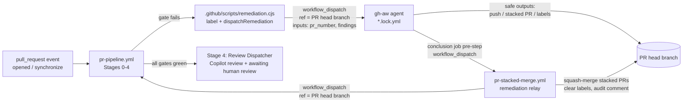

# Remediation Chaining Without Personal Access Tokens

The whole PR lifecycle runs on the repository's default `GITHUB_TOKEN`. GitHub deliberately
does **not** start new workflow runs for events created with that token — labels, pushes,
pull requests, and even `workflow_run` completions of runs that were dispatched with it.
The only events it may create are `workflow_dispatch` and `repository_dispatch`.

The framework therefore chains every hop explicitly with `workflow_dispatch`:



## Building blocks

| Piece | Responsibility |
| :--- | :--- |
| `pr-pipeline.yml` | Runs on `pull_request` **and** `workflow_dispatch(pr_number)`. Stage 0 resolves the PR (number, head/base ref, head SHA) and passes it to every reusable gate, so no gate depends on a `pull_request` payload. |
| `.github/scripts/remediation.cjs` | Shared helper used by every gate: adds/removes labels and dispatches the matching agent on the PR head branch. It skips dispatch when the agent is already running, when an unmerged stacked remediation PR exists, or when the retry budget is exhausted (then it comments once asking for a human). |
| gh-aw agents (`pr-*.md`) | Triggered only by `workflow_dispatch` with `pr_number` and `findings` inputs (the gate's concrete failure output — linter messages, failing tests and coverage, CodeQL rule/file/line). Safe outputs target the PR explicitly. Their `conclusion` job dispatches the relay after safe outputs are applied. |
| `pr-stacked-merge.yml` | The relay. Marks draft stacked PRs ready, squash-merges every open `*-remediation` PR into the parent branch, clears the matching parent labels, posts an audit comment, and re-dispatches the pipeline on the parent branch. |

## Gate → agent mapping

| Gate (stage) | Label | Agent | Fix delivery |
| :--- | :--- | :--- | :--- |
| Pre-Flight Gatekeeper (1a) | `needs-metadata` | `pr-validation.lock.yml` | Edits PR title/body |
| Linters (1b) | `lint-failed` | `pr-lint-fixer.lock.yml` | Pushes to PR branch |
| Tests & Coverage (3a) | `test-required` | `pr-test-generator.lock.yml` | Stacked PR (`test-remediation`) |
| Security — CodeQL (3b) | `codeql-alert` | `pr-codeql-fixer.lock.yml` | Stacked PR (`security-remediation`) |
| Security — Dependency Review (3b) | `dependency-alert` | `pr-dependency-fixer.lock.yml` | Stacked PR (`security-remediation`) |
| Documentation Drift (3c) | `docs-required` | `pr-doc-updater.lock.yml` | Stacked PR (`doc-remediation`) or `docs-not-required` decision |

The build gate (Stage 2) has no agent: a broken build halts the pipeline with `build-failed`.

## Guard rails

- **Retry budget**: each agent may be dispatched at most `MAX_REMEDIATION_ATTEMPTS` times
  (default `4`) per PR branch. After that the PR gets a single "manual intervention required" comment.
- **Serialized agents**: all agent jobs share the `gh-aw-copilot-remediation-agents` concurrency
  group (`queue: max`) and back off on HTTP 429, because parallel agents exhaust the Copilot
  inference rate limit.
- **Pinned model**: agents pin `engine.model` to a chat model enabled for the organization's
  Copilot inference (`gpt-4.1`). The `auto` alias can resolve to models that reject the Copilot
  CLI's custom tools. The list of available models is written to
  `sandbox/firewall/logs/api-proxy-logs/models.json` in every agent run's `agent` artifact.
- **Concurrency**: only `pr-pipeline.yml` declares a concurrency group (`pr-pipeline-<PR>`).
  Reusable workflows must not declare workflow-level concurrency: inside a reusable workflow
  `github.workflow` resolves to the *caller's* name, which deadlocks with the caller's group.

## Optional: using a PAT instead

If a `GH_AW_CI_TRIGGER_TOKEN` (or GitHub App token) is configured, events created by agents
trigger workflows natively. `pr-stacked-merge.yml` keeps its `pull_request` trigger for that
case; the dispatch-based chain continues to work unchanged.

## Manually re-running a hop

```bash
# Re-run the pipeline for PR 42 whose head branch is feat/my-change
gh workflow run pr-pipeline.yml --ref feat/my-change -f pr_number=42

# Re-run an agent with custom findings
gh workflow run pr-test-generator.lock.yml --ref feat/my-change -f pr_number=42 -f findings="tests/foo.test.js fails"

# Consolidate stacked PRs and re-run the pipeline
gh workflow run pr-stacked-merge.yml -f branch=feat/my-change
```
