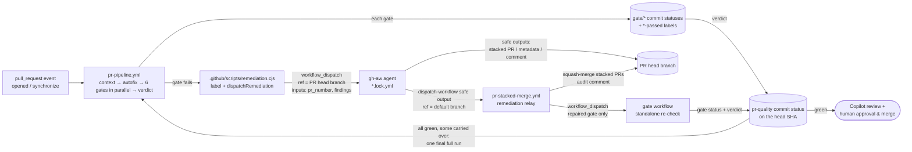

# Remediation Chaining Without Personal Access Tokens

The whole PR lifecycle runs on the repository's default `GITHUB_TOKEN`. GitHub deliberately
does **not** start new workflow runs for events created with that token — labels, pushes,
pull requests, and even `workflow_run` completions of runs that were dispatched with it.
The only events it may create are `workflow_dispatch` and `repository_dispatch`.

The framework therefore chains every hop explicitly with `workflow_dispatch`:



## Check → Repair → Re-check one gate → Final check → Review & merge

1. **Check** — `pr-pipeline.yml` runs once per PR *revision*: the head SHA plus a hash of the PR
   title, body and gate decision labels (`docs-not-required`). An **autofix** job first applies
   `eslint --fix` and `prettier --write` to the changed files and pushes the result, so formatting
   never needs an agent (the push re-dispatches the pipeline on the fixed commit). Then all six gates
   — Metadata, Lint, Build, Tests, Security, Docs — run **in parallel**, so every failure is found
   in the first round. Each gate records its result as a `gate/<id>` commit status on the head SHA
   (mirrored as a `<id>-passed` label), and the verdict job derives `pr-quality` from them. A
   revision that already has a final verdict is not checked again (re-check it with `-f force=true`
   or *Re-run all jobs*).
2. **Repair** — a failing gate labels the PR and dispatches its agent with the concrete findings,
   at most `MAX_REMEDIATION_ATTEMPTS` (default `1`) times per agent and PR branch. Agents for
   different gates repair the PR at the same time.
3. **Re-check one gate** — each agent hands off to the relay, which merges its stacked PRs and then
   re-checks **only the gate that agent repaired**: it marks `gate/<id>` pending on the new head
   commit and dispatches that gate's workflow (e.g. `pr-lint.yml`) on the branch. The results of the
   other gates are carried over from the commit before the merge (status description
   `carried from <sha7>: …`); gates that have no result yet are re-checked too. The standalone gate
   records its result and calls `pr-quality-verdict.yml`:
   - a gate still checking → `pr-quality` stays **pending**;
   - a gate failed while another agent, stacked PR or relay is still working on the branch →
     **pending** ("Repairing: …");
   - a gate failed and nothing is repairing it any more → **failure**, with a single comment listing
     the failed gates and the re-run command. There is no second automatic attempt with the default
     budget.
   Agents never remove gate labels or set statuses: an agent reporting "fixed" is never a substitute
   for a passing gate.
4. **Final check** — when every gate is green but some results were carried over from an earlier
   commit, the verdict dispatches **one** full pipeline run (`force=true`) on the final head, so the
   combined fixes are verified together (a lint fix could break a test). If that run passes,
   `pr-quality` turns green.
5. **Review & merge** — automation stops here. Only stacked remediation PRs are merged
   automatically (into the feature branch); the feature PR itself is never auto-merged. Once
   `pr-quality` is green, the verdict requests a Copilot review (`pr-review-dispatcher.yml`) and a
   human gives the final approval and merges.

With four failing gates, the PR is checked once, repaired by four agents, re-checked gate by gate
(minutes each) and confirmed by one final full run — instead of one full pipeline per repair round.

## Building blocks

| Piece | Responsibility |
| :--- | :--- |
| `pr-pipeline.yml` | Runs on `pull_request` **and** `workflow_dispatch(pr_number, force)`. The context job resolves the PR (number, head/base ref, head SHA, revision), de-duplicates already-checked revisions and sets `pr-quality` to `pending`; the autofix job pushes deterministic lint/format fixes (or marks every `gate/<id>` pending); the six gates run in parallel; the verdict job publishes `pr-quality`. New pushes cancel a running check; dispatched runs queue behind it. |
| `.github/scripts/remediation.cjs` | Shared helper used by every gate: adds/removes labels and dispatches the matching agent on the PR head branch. It skips dispatch when the agent is already running, when an unmerged stacked remediation PR exists, or when the retry budget is exhausted (then it comments once asking for a human). |
| `.github/scripts/pr-quality.cjs` | Revision fingerprint and `pr-quality` status; `gate/<id>` statuses and `<id>-passed` labels (`recordGate`, `startGates`); `recheckGates` (re-check repaired gates, carry the others over); `evaluateVerdict` (pending / repairing / failure / final check / success); detection of remediation still in progress. |
| `pr-quality-verdict.yml` | Reusable verdict called by a gate re-checked alone (also `workflow_dispatch(pr_number)`). One verdict per PR at a time (`pr-quality-verdict-<PR>` concurrency group). Every 15 minutes it runs as the watchdog for stalled `pr-quality` statuses. |
| Reusable gates | Called by the pipeline via `workflow_call` (`from_pipeline: true`, `head_sha`). Each also has a `workflow_dispatch` that takes only `pr_number`; head/base refs and head SHA are resolved from the PR, and the run fails if it was not dispatched on the PR head branch. Every gate ends with a *Record gate result* step, and when run alone, a `verdict` job. They do not declare workflow-level concurrency. Gates are the only writers of their labels and `gate/<id>` statuses. |
| gh-aw agents (`pr-*.md`) | Triggered only by `workflow_dispatch` with `pr_number` and `findings` inputs (the gate's concrete failure output — linter messages, failing tests and coverage, CodeQL rule/file/line). Safe outputs target the PR explicitly and cannot remove gate labels. They are purely declarative — a natural-language prompt plus gh-aw frontmatter (no `steps:`/`jobs:` scripts) — and hand off to the relay with the `dispatch-workflow` safe output as their last action. |
| `pr-stacked-merge.yml` | The relay (run name `Remediation relay for <branch>`). Marks draft stacked PRs ready, squash-merges every open `*-remediation` PR into the parent branch, posts an audit comment naming the gate being re-checked, waits for a running pipeline, then re-checks the repaired gates on the new head (carrying the others over) and updates `pr-quality`. It does not wait for other agents: each agent's own relay re-checks its gate. |

## Gate → agent mapping

| Gate (`gate/<id>`) | Label | Agent | Fix delivery |
| :--- | :--- | :--- | :--- |
| Metadata (`gate/metadata`) | `needs-metadata` | `pr-validation.lock.yml` | Edits PR title/body |
| Lint (`gate/lint`) | `lint-failed` | `pr-lint-fixer.lock.yml` (only for what autofix cannot fix) | Stacked PR (`lint-remediation`) |
| Tests & Coverage (`gate/tests`) | `test-required` | `pr-test-generator.lock.yml` | Stacked PR (`test-remediation`) |
| Security — CodeQL (`gate/security`) | `codeql-alert` | `pr-codeql-fixer.lock.yml` | Stacked PR (`security-remediation`) |
| Security — Dependency Review (`gate/security`) | `dependency-alert` | `pr-dependency-fixer.lock.yml` | Stacked PR (`security-remediation`) |
| Documentation Drift (`gate/docs`) | `docs-required` | `pr-doc-updater.lock.yml` | Stacked PR (`doc-remediation`) or `docs-not-required` decision |

The build gate (`gate/build`) has no agent: a broken build sets `build-failed` and fails
`pr-quality` once no other repair is in progress. The other gates still run, so their findings are
not hidden behind the build failure.

A passing gate adds `<id>-passed` (e.g. `lint-passed`) when its result is for the current PR head;
any other result removes it. The labels are a convenience view; branch protection should require
the `pr-quality` status, which is tied to the exact commit.

## Guard rails

- **Retry budget**: each agent may be dispatched at most `MAX_REMEDIATION_ATTEMPTS` times
  (repository variable, default `1`) per PR branch. With the default, a gate that still fails after
  its repair fails `pr-quality` instead of starting another round. After the budget is spent the PR
  gets a single "manual intervention required" comment.
- **Serialized agents**: all agent jobs share the `gh-aw-copilot-remediation-agents` concurrency
  group (`queue: max`) and back off on HTTP 429, because parallel agents exhaust the Copilot
  inference rate limit. Gates find all failures at once and dispatch every agent immediately, but
  the agents themselves still run one after another; each relay re-checks its gate as soon as its
  agent finishes.
- **Configurable model**: agents use `engine.model: ${{ vars.GH_AW_AGENT_MODEL || 'gpt-4.1' }}`.
  The `auto` alias can resolve to models that reject the Copilot CLI's custom tools, and individual
  models can hit organization rate limits (`429`). Switch models by updating the repository variable;
  the list of available models is written to `sandbox/firewall/logs/api-proxy-logs/models.json`
  in every agent run's `agent` artifact.
- **Token-frugal agents**: each prompt tells the agent to read the PR diff once, starts from the
  gate findings, and scopes the files to read and the number of tool calls. Unscoped agents were observed
  spending 60+ requests (~1.7M input tokens) on a single documentation change, which exhausts organization rate limits.
- **Agents run on the PR head branch only**: an agent edits the branch it was dispatched on and
  opens its stacked PR against it, and the sandbox firewall blocks `git fetch` of other branches.
  A run dispatched on the default branch (e.g. a manual run left on `main` in the Actions UI) is
  skipped by the workflow-level `if:`; for any other branch, the prompt's *Before You Start* section
  has the agent confirm the PR is open and its head branch is checked out, and otherwise `noop`
  with re-dispatch advice.
- **Agent crashes**: the relay hand-off is a safe output, so an agent run that fails before
  emitting it does not trigger a re-check. The watchdog notices the stalled `pr-quality` and, once
  no agent, stacked PR or relay is working on the branch any more, fails it with the re-run command; re-run the pipeline
  with `gh workflow run pr-pipeline.yml --ref <branch> -f pr_number=<PR> -f force=true` once the
  cause is fixed.
- **Fail closed on agent errors**: a gate is only green when its own check passes on the commit
  being verified; agent success, a merged stacked PR or a carried-over result alone never make
  `pr-quality` green (carried results always trigger the final full run). Cancelled/skipped agent
  runs do not consume the retry budget.
- **Stale results**: `gate/<id>` statuses live on commits, so a new push starts from scratch. A
  gate result for a commit that is no longer the PR head never changes the `<id>-passed` labels.
  A pipeline run whose commit is no longer the PR head (e.g. a queued dispatch) checks nothing:
  it skips, and a dispatched run re-dispatches itself on the new head.
- **Metadata repairs**: gate statuses record the PR revision they checked. Metadata and Docs
  results recorded for a different title, body or decision label are re-checked by the next relay
  or watchdog, so a PR Validation or `docs-not-required` repair is not lost when its relay run is
  replaced in the relay's concurrency queue.
- **Blocked stacked PRs**: a stacked PR the relay cannot merge gets `remediation-blocked` and a
  comment; it no longer counts as a repair in progress, so `pr-quality` fails instead of waiting.
- **Watchdog**: `pr-quality-verdict.yml` also runs every 15 minutes. A PR whose `pr-quality` has
  been pending for `STALE_VERDICT_MINUTES` (repository variable, default `30`) with no pipeline or
  relay running — e.g. an agent crashed before handing off to the relay — gets its stuck gates
  re-checked and a fresh verdict.
- **Autofix**: only pushes to same-repository PR branches (also for dispatched runs), skips a head
  that is already an auto-fix commit, and never fails the pipeline.
- **Concurrency**: `pr-pipeline.yml` declares `pr-pipeline-<PR>` (`pull_request` runs cancel
  in-progress checks, dispatched runs queue); verdict jobs share `pr-quality-verdict-<PR>` so
  gates finishing together publish one verdict at a time.
  Reusable workflows must not declare workflow-level concurrency: inside a reusable workflow
  `github.workflow` resolves to the *caller's* name, which deadlocks with the caller's group.

## Optional: using a PAT instead

If a `GH_AW_CI_TRIGGER_TOKEN` (or GitHub App token) is configured, events created by agents
trigger workflows natively. `pr-stacked-merge.yml` keeps its `pull_request` trigger for that
case; the dispatch-based chain continues to work unchanged.

## Manually re-running a hop

```bash
# Re-run the pipeline for PR 42 whose head branch is feat/my-change
# (force=true re-checks a revision that already has a pr-quality verdict)
gh workflow run pr-pipeline.yml --ref feat/my-change -f pr_number=42 -f force=true

# Re-run a single gate on the PR head branch (refs are resolved from the PR); it records
# gate/lint and updates pr-quality
gh workflow run pr-lint.yml --ref feat/my-change -f pr_number=42

# Recompute the pr-quality verdict from the gate statuses
gh workflow run pr-quality-verdict.yml -f pr_number=42

# Re-run an agent with custom findings
gh workflow run pr-test-generator.lock.yml --ref feat/my-change -f pr_number=42 -f findings="tests/foo.test.js fails"

# Consolidate stacked PRs and re-check the gates they repaired
gh workflow run pr-stacked-merge.yml -f branch=feat/my-change
```

## Testing the workflows

`tests/workflows/` exercises the orchestration logic offline with Vitest (`npm run test:workflows`;
also part of `npm test`). The inline `actions/github-script` blocks are extracted from the workflow
YAML and executed against an in-memory fake of the GitHub API (`tests/workflows/helpers/harness.js`),
so the tests run the exact code that runs in Actions.

| Suite | Covers |
|---|---|
| `remediation.test.js` | Label helpers, `commentOnce`, `dispatchRemediation` (dispatch, already running, pending stacked PR, budget exhaustion, cancelled runs not counted, truncation, API errors) |
| `pr-quality.test.js` | Revision fingerprint, `pr-quality` status round-trip and 140-char limit, pending agent detection, gate statuses and `<id>-passed` labels, `remediationInProgress` (incl. blocked stacked PRs), `recheckGates` (incl. metadata revisions), every `evaluateVerdict` outcome, the `sweepStalled` watchdog |
| `pipeline.test.js` | Triggers/concurrency/job graph (autofix, parallel gates), context job (new revision, stale/fork runs, duplicate verdict skip, metadata/decision-label changes, `force`, re-run attempts, closed/stacked PRs, wrong ref), autofix, verdict job |
| `relay.test.js` | Stacked PR merge (drafts, failures, branch cleanup), per-gate re-check with carried results, parallel repairs, repairs without a new commit, waiting for the pipeline, final failure |
| `gates.test.js` | Every gate's handlers (metadata, lint, build, tests, docs, security, review dispatcher), *Record gate result* steps, standalone `verdict` jobs, `pr-quality-verdict.yml` |
| `agents.test.js` | gh-aw agent contracts: declarative (no scripted steps/jobs), skipped on the default branch, dispatch-only, no direct pushes or gate-label removal, stacked labels match gates, lock files in sync, relay hand-off |

Run `gh aw compile` after editing an agent `.md` file; `agents.test.js` fails when a lock file's
safe outputs or relay hand-off no longer match the source.
