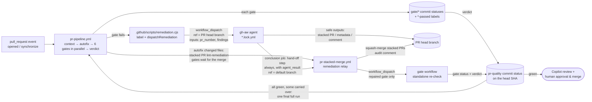

# Remediation Chaining Without Personal Access Tokens

The whole PR lifecycle runs on the repository's default `GITHUB_TOKEN`. GitHub deliberately
does **not** start new workflow runs for events created with that token — labels, pushes,
pull requests, and even `workflow_run` completions of runs that were dispatched with it.
Only `workflow_dispatch` and `repository_dispatch` start runs. `pull_request` `opened`,
`synchronize` and `reopened` events create runs held in an **approval-required** state
([docs](https://docs.github.com/en/actions/concepts/security/github_token#when-github_token-triggers-workflow-runs)),
which never execute on their own.

To keep those held runs out of the Actions list, `pr-pipeline.yml` only listens to PRs that
target `main` (stacked remediation PRs target the feature branch), and `pr-stacked-merge.yml`
has no `pull_request` trigger at all. Every automated change reaches a feature branch the same way —
as a stacked PR that the relay squash-merges (the lint autofix included), so the relay merge is the
only bot push. It can use a GitHub App token instead, so its `synchronize` run is the re-check and
no held run is left behind — see
[GitHub App for bot pushes](#recommended-github-app-for-bot-pushes).

The framework therefore chains every hop explicitly with `workflow_dispatch`:



## Check → Repair → Re-check one gate → Final check → Review & merge

1. **Check** — `pr-pipeline.yml` runs once per PR *revision*: the head SHA plus a hash of the PR
   title, body and gate decision labels (`docs-not-required`). An **autofix** job first applies
   `eslint --fix` and `prettier --write` to the changed files, so formatting never needs an agent.
   Like every automated change, the fix does not land on the feature branch directly: it is
   committed to `lint-autofix/pr-<number>`, opened as a stacked PR (`lint-remediation`) and handed
   to the relay (source `Lint auto-fix (run <id>)`), which squash-merges it. No gate ran on the
   unfixed commit, so the merged commit gets the full check (started natively by the
   [GitHub App](#recommended-github-app-for-bot-pushes) merge, or by the relay re-checking every
   gate without it). When there is nothing to fix, all six gates
   — Metadata, Lint, Build, Tests, Security, Docs — run **in parallel**, so every failure is found
   in the first round. Each gate records its result as a `gate/<id>` commit status on the head SHA
   (mirrored as a `<id>-passed` label), and the verdict job derives `pr-quality` from them. A
   revision that already has a final verdict is not checked again (re-check it with `-f force=true`
   or *Re-run all jobs*).
2. **Repair** — a failing gate labels the PR and dispatches its agent with the concrete findings,
   at most `MAX_REMEDIATION_ATTEMPTS` (default `1`) times per agent and PR branch. Agents for
   different gates repair the PR at the same time.
3. **Re-check one gate** — every agent run hands off to the relay when it ends, whatever its
   result. When the agent applied a repair, the relay merges its stacked PRs and then
   re-checks **only the gate that agent repaired**: it marks `gate/<id>` pending on the new head
   commit and dispatches that gate's workflow (e.g. `pr-lint.yml`) on the branch. When the agent
   failed or changed nothing, the relay re-checks nothing and publishes the verdict straight away. The results of the
   other gates are carried over from the commit before the merge (status description
   `carried from <sha7>: …`); gates that have no result yet are re-checked too. The standalone gate
   records its result and calls `pr-quality-verdict.yml`:
   - a gate still checking → `pr-quality` stays **pending**;
   - a gate failed while another agent, stacked PR or relay is still working on the branch →
     **pending** ("Repairing: …");
   - a gate failed and nothing is repairing it any more → **failure**, with a single comment listing
     the failed gates and the re-run command. There is no second automatic attempt with the default
     budget.
   Agents never remove gate labels or set statuses: an agent reporting "fixed" is never a substitute
   for a passing gate.
4. **Final check** — when every gate is green but some results were carried over from an earlier
   commit, the verdict dispatches **one** full pipeline run (`force=true`) on the final head, so the
   combined fixes are verified together (a lint fix could break a test). If that run passes,
   `pr-quality` turns green.
5. **Review & merge** — automation stops here. Only stacked remediation PRs are merged
   automatically (into the feature branch); the feature PR itself is never auto-merged. Once
   `pr-quality` is green, the verdict requests a Copilot review (`pr-review-dispatcher.yml`) and a
   human gives the final approval and merges.

With four failing gates, the PR is checked once, repaired by four agents, re-checked gate by gate
(minutes each) and confirmed by one final full run — instead of one full pipeline per repair round.

## Building blocks

| Piece | Responsibility |
| :--- | :--- |
| `pr-pipeline.yml` | Runs on `pull_request` **and** `workflow_dispatch(pr_number, force)`. The context job resolves the PR (number, head/base ref, head SHA, revision), de-duplicates already-checked revisions and sets `pr-quality` to `pending`; the autofix job proposes deterministic lint/format fixes as a stacked PR and hands off to the relay (or marks every `gate/<id>` pending); the six gates run in parallel; the verdict job publishes `pr-quality`. A Bot-sent push made only of relay merges (`Recheck-Gates` trailer) runs the `recheck` job instead of the full check, unless no gate was checked before the merges (the merged autofix). Human pushes cancel a running check; dispatched and Bot-sent runs queue behind it. |
| `.github/scripts/remediation.cjs` | Shared helper used by every gate: adds/removes labels and dispatches the matching agent on the PR head branch. It skips dispatch when the agent is already running, when an unmerged stacked remediation PR exists, or when the retry budget is exhausted (then it comments once asking for a human). |
| `.github/scripts/pr-quality.cjs` | Revision fingerprint and `pr-quality` status; `gate/<id>` statuses and `<id>-passed` labels (`recordGate`, `startGates`); `recheckGates` (re-check repaired gates, carry the others over); `evaluateVerdict` (pending / repairing / failure / final check / success); detection of remediation still in progress. |
| `pr-quality-verdict.yml` | Reusable verdict called by a gate re-checked alone (also `workflow_dispatch(pr_number)`). One verdict per PR at a time (`pr-quality-verdict-<PR>` concurrency group). Every 15 minutes it runs as the watchdog for stalled `pr-quality` statuses. |
| Reusable gates | Called by the pipeline via `workflow_call` (`from_pipeline: true`, `head_sha`). Each also has a `workflow_dispatch` that takes only `pr_number`; head/base refs and head SHA are resolved from the PR, and the run fails if it was not dispatched on the PR head branch. Every gate ends with a *Record gate result* step, and when run alone, a `verdict` job. They do not declare workflow-level concurrency. Gates are the only writers of their labels and `gate/<id>` statuses. |
| gh-aw agents (`pr-*.md`) | Triggered only by `workflow_dispatch` with `pr_number` and `findings` inputs (the gate's concrete failure output — linter messages, failing tests and coverage, CodeQL rule/file/line). Safe outputs target the PR explicitly and cannot remove gate labels. They are declarative — a natural-language prompt plus gh-aw frontmatter (no `steps:`/`jobs:` scripts of their own) — and cannot dispatch workflows. Each imports `shared/remediation-handoff.md`, whose deterministic *Hand off to the remediation relay* step in the generated `conclusion` job (which runs after the agent and its safe outputs, whatever their result) dispatches the relay with `agent_result`: `success` when a repair was applied (stacked PR, PR metadata edit or decision label), `no-changes`, the agent job's result (`failure`, `cancelled`, `skipped`) or `safe-outputs-<result>`. |
| `pr-stacked-merge.yml` | The relay (run name `Remediation relay for <branch>`). Marks draft stacked PRs ready, squash-merges every open `*-remediation` PR into the parent branch, posts an audit comment naming the gate being re-checked, waits for a running pipeline, then re-checks the repaired gates on the new head (carrying the others over) and updates `pr-quality`. Only an `agent_result` of `success` (or a manual run without one) re-checks the dispatching agent's gate; any other result re-checks nothing new, so the still-failing gate fails `pr-quality` fast. With the GitHub App configured it merges with the App token and stops there: the pipeline run started by the merge re-checks the gates named in the commit's `Recheck-Gates` trailer. It does not wait for other agents: each agent's own relay re-checks its gate. A stacked PR that conflicts with the branch is closed as `remediation-superseded` and its gate re-checked, so the fix is regenerated once on the current head ([Merge conflicts](#merge-conflicts)). |
| `pr-merge-conflicts.yml` | Runs on every push (GitHub never starts `pull_request` runs for conflicting PRs). Flags open PRs into `main` that conflict with it — all of them after a push to `main`, the branch's own PR otherwise — with a `pr-quality` failure and one comment explaining how to resolve. |

## Gate → agent mapping

| Gate (`gate/<id>`) | Label | Agent | Fix delivery |
| :--- | :--- | :--- | :--- |
| Metadata (`gate/metadata`) | `needs-metadata` | `pr-validation.lock.yml` | Edits PR title/body |
| Lint (`gate/lint`) | `lint-failed` | Pipeline autofix (before the gates), then `pr-lint-fixer.lock.yml` for what autofix cannot fix | Stacked PR (`lint-remediation`) |
| Tests & Coverage (`gate/tests`) | `test-required` | `pr-test-generator.lock.yml` | Stacked PR (`test-remediation`) |
| Security — CodeQL (`gate/security`) | `codeql-alert` | `pr-codeql-fixer.lock.yml` | Stacked PR (`security-remediation`) |
| Security — Dependency Review (`gate/security`) | `dependency-alert` | `pr-dependency-fixer.lock.yml` | Stacked PR (`security-remediation`) |
| Documentation Drift (`gate/docs`) | `docs-required` | `pr-doc-updater.lock.yml` | Stacked PR (`doc-remediation`) or `docs-not-required` decision |

The build gate (`gate/build`) has no agent: a broken build sets `build-failed` and fails
`pr-quality` once no other repair is in progress. The other gates still run, so their findings are
not hidden behind the build failure.

A passing gate adds `<id>-passed` (e.g. `lint-passed`) when its result is for the current PR head;
any other result removes it. The labels are a convenience view; branch protection should require
the `pr-quality` status, which is tied to the exact commit.

## Guard rails

- **Retry budget**: each agent may be dispatched at most `MAX_REMEDIATION_ATTEMPTS` times
  (repository variable, default `1`) per PR branch. With the default, a gate that still fails after
  its repair fails `pr-quality` instead of starting another round. After the budget is spent the PR
  gets a single "manual intervention required" comment.
- **Serialized agents**: all agent jobs share the `gh-aw-copilot-remediation-agents` concurrency
  group (`queue: max`) and back off on HTTP 429, because parallel agents exhaust the Copilot
  inference rate limit. Gates find all failures at once and dispatch every agent immediately, but
  the agents themselves still run one after another; each relay re-checks its gate as soon as its
  agent finishes.
- **Configurable model**: agents use `engine.model: ${{ vars.GH_AW_AGENT_MODEL || 'gpt-4.1' }}`.
  The `auto` alias can resolve to models that reject the Copilot CLI's custom tools, and individual
  models can hit organization rate limits (`429`). Switch models by updating the repository variable;
  the list of available models is written to `sandbox/firewall/logs/api-proxy-logs/models.json`
  in every agent run's `agent` artifact.
- **Token-frugal agents**: each prompt tells the agent to read the PR diff once, starts from the
  gate findings, and scopes the files to read and the number of tool calls. Unscoped agents were observed
  spending 60+ requests (~1.7M input tokens) on a single documentation change, which exhausts organization rate limits.
- **Agents run on the PR head branch only**: an agent edits the branch it was dispatched on and
  opens its stacked PR against it, and the sandbox firewall blocks `git fetch` of other branches.
  A run dispatched on the default branch (e.g. a manual run left on `main` in the Actions UI) is
  skipped by the workflow-level `if:`; for any other branch, the prompt's *Before You Start* section
  has the agent confirm the PR is open and its head branch is checked out, and otherwise `noop`
  with re-dispatch advice.
- **Agent crashes and empty runs**: the relay hand-off does not depend on the model. The
  `conclusion` job, which gh-aw runs after the agent and its safe outputs whatever their result,
  always dispatches the relay (step *Hand off to the remediation relay*, imported from
  `shared/remediation-handoff.md`), so a run that crashes (HTTP 429, timeout, sandbox error),
  gives up or changes nothing still reaches it. With an `agent_result` other than `success` the
  relay re-checks nothing — the commit did not change, so a re-check would only spend another
  remediation attempt — and the still-failing gate fails `pr-quality` with the error comment and
  re-run command, or keeps it pending while other agents, stacked PRs or relays are still repairing
  the PR (the last of them publishes it). The step never fails the agent run. Re-run the pipeline
  with `gh workflow run pr-pipeline.yml --ref <branch> -f pr_number=<PR> -f force=true` once the
  cause is fixed. The watchdog remains a backstop for runs cancelled before their `conclusion` job.
- **Fail closed on agent errors**: a gate is only green when its own check passes on the commit
  being verified; agent success, a merged stacked PR or a carried-over result alone never make
  `pr-quality` green (carried results always trigger the final full run). Cancelled/skipped agent
  runs do not consume the retry budget.
- **Stale results**: `gate/<id>` statuses live on commits, so a new push starts from scratch. A
  gate result for a commit that is no longer the PR head never changes the `<id>-passed` labels.
  A pipeline run whose commit is no longer the PR head (e.g. a queued dispatch) checks nothing:
  it skips, and a dispatched run re-dispatches itself on the new head.
- **Metadata repairs**: gate statuses record the PR revision they checked. Metadata and Docs
  results recorded for a different title, body or decision label are re-checked by the next relay
  or watchdog, so a PR Validation or `docs-not-required` repair is not lost when its relay run is
  replaced in the relay's concurrency queue.
- **Blocked stacked PRs**: a stacked PR the relay cannot merge gets `remediation-blocked` and a
  comment; it no longer counts as a repair in progress, so `pr-quality` fails instead of waiting.
  A stacked PR that merely *conflicts* is regenerated once first — see
  [Merge conflicts](#merge-conflicts).
- **Watchdog**: `pr-quality-verdict.yml` also runs every 15 minutes. A PR whose `pr-quality` has
  been pending for `STALE_VERDICT_MINUTES` (repository variable, default `30`) with no pipeline or
  relay running — e.g. an agent run cancelled before its hand-off step could run — gets its stuck gates
  re-checked and a fresh verdict. Scheduled runs can be delayed or skipped by GitHub, so the
  watchdog is a backstop, not the primary failure path.
- **Autofix**: only runs for same-repository PR branches (also for dispatched runs), never pushes
  to the feature branch (it force-pushes `lint-autofix/pr-<number>` and reuses that stacked PR if it
  is still open), skips a head that is an already merged auto-fix (`[pr-autofix]` in the squash
  title), and never fails the pipeline.
- **Concurrency**: `pr-pipeline.yml` declares `pr-pipeline-<PR>` (human `pull_request` pushes cancel
  in-progress checks, dispatched and Bot-sent runs queue); verdict jobs share `pr-quality-verdict-<PR>` so
  gates finishing together publish one verdict at a time.
  Reusable workflows must not declare workflow-level concurrency: inside a reusable workflow
  `github.workflow` resolves to the *caller's* name, which deadlocks with the caller's group.

## Merge conflicts

Two kinds of conflicts can occur, and they are handled where they arise:

| Conflict | Typical cause | Handling |
| :--- | :--- | :--- |
| Stacked remediation PR ↔ feature branch | Agents run one after another, each from the commit it was dispatched on; an earlier fix (or an author push) changed the same lines | **Automatic, bounded**: the relay closes the stale fix and has it regenerated on the current head |
| Feature PR ↔ `main` | `main` moved, or the author pushed a conflicting commit | **Detected, left to the author**: `pr-quality` fails with resolve instructions |

### Stacked PR conflicts: regenerate, don't resolve

When the relay's squash-merge fails, it asks GitHub whether the stacked PR conflicts with the
parent branch (`mergeable`, polled while GitHub is still computing it). Other failures (permissions,
branch rules, API errors) are blocked as before. For a real conflict the relay:

1. labels the stacked PR `remediation-superseded`, closes it and deletes its branch;
2. comments on the parent PR and re-checks the stacked PR's gate on the current head commit (the
   App path does this too, since a superseded PR is not part of any `Recheck-Gates` trailer);
3. if the gate passes — another repair already fixed it — nothing else happens. If it still fails,
   the gate dispatches its agent again with fresh findings for the current code. A superseded
   stacked PR gives its agent attempt back (`dispatchRemediation` subtracts superseded PRs of the
   same label from the attempts), so this works with `MAX_REMEDIATION_ATTEMPTS=1`.

Regenerating a small fix from fresh findings is cheaper and safer than resolving conflict markers:
the agent keeps its scope rules (e.g. test files only) and the result is checked by the gate like
any other repair. It happens **once per remediation label and branch**; a second conflict gets
`remediation-blocked` and a manual-merge comment.

### Conflicts with `main`: detect early, hand to the author

GitHub [does not start `pull_request` workflows for a PR that has a merge conflict](https://docs.github.com/en/actions/reference/workflows-and-actions/events-that-trigger-workflows#pull_request),
so without help the pipeline silently never runs and `pr-quality` stays on an older commit — or
stays green after `main` moved. `pr-merge-conflicts.yml` runs on every push instead:

- a push to `main` checks every open PR into `main`;
- a push to any other branch checks that branch's PR.

A conflicting PR gets `pr-quality` = **failure** (`Merge conflict with main: …`) and one comment per
head commit with the `git merge origin/main` commands. The resolving push starts the pipeline as
usual; a conflict-only verdict is never treated as a final verdict for de-duplication. The pipeline's
context job and `evaluateVerdict` apply the same check, so a dispatched run never checks — and
`pr-quality` never turns green on — a PR that cannot merge.

Conflicts with `main` are not resolved by an agent: they decide how this change combines with what
landed on `main`, which is the author's call. For the window between a `main` push and a stale green
`pr-quality`, enable **Require branches to be up to date before merging** in branch protection.

## Recommended: GitHub App for bot pushes

With `GITHUB_TOKEN` only, every bot push to a feature branch leaves an approval-held
`pull_request` run ("Action required") next to the run that was dispatched for it. The only bot
push is the relay's squash-merge of stacked PRs (the lint autofix is a stacked PR too).
Configure a GitHub App to remove that noise:

1. Create a GitHub App (no webhook) with repository permissions **Contents: Read and write**,
   **Pull requests: Read and write** (Metadata: read is implied) and install it on this
   repository only.
2. Set the repository variable `PR_BOT_CLIENT_ID` to the App's client ID and the secret
   `PR_BOT_PRIVATE_KEY` to its private key.

When both are set (and the PR targets the default branch), the relay merges under the App
(`actions/create-github-app-token`) and the native `synchronize` run does the work that a
dispatch used to do:

| Bot push | Without the App | With the App |
| :--- | :--- | :--- |
| Relay squash-merge of stacked PRs | held run + relay re-checks the repaired gates | relay stops after merging; the pipeline run re-checks the repaired gates |
| Relay squash-merge of the autofix stacked PR | held run + relay checks every gate (none ran yet) | relay stops after merging; the pipeline run does the full check |

The relay writes a `Recheck-Gates: <gate ids>` trailer into each squash-merge commit message.
When a Bot-sent `synchronize` contains only such commits, the pipeline's context job switches to
**recheck** mode: it skips the full check and its `recheck` job calls the same `recheckGates` and
verdict logic the relay uses (repaired gates re-run, the others carried over). Earlier relay merges
whose re-check was replaced in the concurrency queue are folded in. When no gate was ever checked
before the merges (the autofix stacked PR is proposed before the gates run), there is nothing to
carry over and the push gets the full check. Any other push — human, force-push, or a mix — gets
the full check. Bot-sent pipeline runs queue instead of
cancelling each other, so a re-check is never lost.

Without the App (or if minting the token fails) the workflows fall back to the dispatch chain
above. Don't use a PAT as `GH_AW_CI_TRIGGER_TOKEN`: it would also make agent-opened stacked PRs
start runs, which the trigger filters exist to avoid.

## Manually re-running a hop

```bash
# Re-run the pipeline for PR 42 whose head branch is feat/my-change
# (force=true re-checks a revision that already has a pr-quality verdict)
gh workflow run pr-pipeline.yml --ref feat/my-change -f pr_number=42 -f force=true

# Re-run a single gate on the PR head branch (refs are resolved from the PR); it records
# gate/lint and updates pr-quality
gh workflow run pr-lint.yml --ref feat/my-change -f pr_number=42

# Recompute the pr-quality verdict from the gate statuses
gh workflow run pr-quality-verdict.yml -f pr_number=42

# Re-run an agent with custom findings
gh workflow run pr-test-generator.lock.yml --ref feat/my-change -f pr_number=42 -f findings="tests/foo.test.js fails"

# Consolidate stacked PRs and re-check the gates they repaired
gh workflow run pr-stacked-merge.yml -f branch=feat/my-change
```

## Testing the workflows

`tests/workflows/` exercises the orchestration logic offline with Vitest (`npm run test:workflows`;
also part of `npm test`). The inline `actions/github-script` blocks are extracted from the workflow
YAML and executed against an in-memory fake of the GitHub API (`tests/workflows/helpers/harness.js`),
so the tests run the exact code that runs in Actions.

| Suite | Covers |
|---|---|
| `remediation.test.js` | Label helpers, `commentOnce`, `dispatchRemediation` (dispatch, already running, pending stacked PR, budget exhaustion, cancelled runs not counted, superseded stacked PRs refunded, truncation, API errors) |
| `pr-quality.test.js` | Revision fingerprint, `pr-quality` status round-trip and 140-char limit, pending agent detection, gate statuses and `<id>-passed` labels, `remediationInProgress` (incl. blocked stacked PRs), `recheckGates` (incl. metadata revisions), every `evaluateVerdict` outcome (incl. conflicts with the base), the `sweepStalled` watchdog, `mergeability` polling and `flagBaseConflicts` |
| `pipeline.test.js` | Triggers/concurrency/job graph (autofix, parallel gates), context job (new revision, stale/fork runs, duplicate verdict skip, metadata/decision-label changes, `force`, re-run attempts, closed/stacked PRs, wrong ref, merged autofix gets the full check, conflicts with `main`), autofix stacked PR and relay hand-off, verdict job |
| `relay.test.js` | Stacked PR merge (drafts, failures, branch cleanup), per-gate re-check with carried results, parallel repairs, repairs without a new commit, waiting for the pipeline, final failure, the autofix stacked PR, conflicting stacked PRs (superseded and regenerated once, then blocked; App path) |
| `merge-conflicts.test.js` | `pr-merge-conflicts.yml`: push trigger and permissions, PRs flagged after a push to `main` vs. a feature branch |
| `gates.test.js` | Every gate's handlers (metadata, lint, build, tests, docs, security, review dispatcher), *Record gate result* steps, standalone `verdict` jobs, `pr-quality-verdict.yml` |
| `agents.test.js` | gh-aw agent contracts: declarative (no scripted steps/jobs), skipped on the default branch, dispatch-only, no direct pushes or gate-label removal, stacked labels match gates, lock files in sync, the shared relay hand-off compiled into every `conclusion` job (`agent_result` for repairs, no changes, crashes and failed safe outputs) |

Run `gh aw compile` after editing an agent `.md` file; `agents.test.js` fails when a lock file's
safe outputs or relay hand-off no longer match the source.
