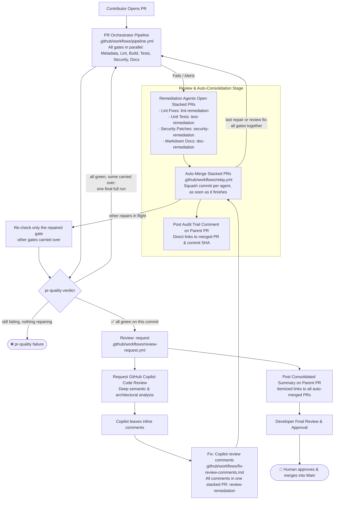

# Step 7: Automated Consolidation, Copilot Review & Developer Sign-Off

This module solves **notification and review fatigue** by automatically consolidating agentic stacked PRs into the developer's branch with transparent audit trails, requesting GitHub Copilot semantic review, and guiding the developer through a single final sign-off.

---

## 💡 Why This Framework is Relevant: Solving Review Fatigue

Without consolidation, autonomous agents running in parallel can overwhelm engineers with disjointed pull requests, repetitive CI runs, and constant context switching:

- **Zero Human Churn**: Developers aren't interrupted every 5 minutes to review 4 minor stacked PRs. The pipeline auto-merges them into the feature branch.
- **Auditability & Traceability**: Because each agent created its own stacked PR, there is a clean git history and PR record for *why* a test was added or a security patch was merged.
- **Transparency via Comments**: Commenting on the parent PR keeps the author informed of everything that was auto-merged.
- **Final Single Review**: Copilot reviews the final, clean, remediated branch, and the human author only does **one comprehensive review** of all auto-remediated changes plus Copilot's review feedback.

### Impact on Delivery & Velocity

| Metric | Traditional Human-Only CI/CD | Our Autonomous PR Lifecycle |
| :--- | :--- | :--- |
| **Average Time-to-Merge (TTM)** | **2 to 5 business days** (waiting for peer reviewers to wake up, point out missing tests, request formatting fixes, wait for changes, re-review) | **15 to 45 minutes** |
| **CI/CD Pipeline Run Time** | 3 to 10 minutes per push | 2 to 5 minutes per push |
| **Review Cycles** | 3–4 back-and-forth round trips over days | **1 single review session** by the developer |

---

## Architecture Overview

---

## 1. Relay: merge stacked fixes (`.github/workflows/relay.yml`)

Instead of pinging the developer to manually review and merge 3–4 separate stacked PRs (the relay is dispatched by each agent run's `conclusion` job when it ends, whatever its result, because PRs created with `GITHUB_TOKEN` only raise approval-held `pull_request` runs — see [Remediation Chaining](remediation-chaining.md)):
- **Automatic Ingestion**: Automatically merges valid remediation PRs with labels (`lint-remediation`, `test-remediation`, `security-remediation`, `doc-remediation`, `review-remediation`) targeting the feature branch.
- **Ready & Squash & Delete**: Marks draft stacked PRs ready, squashes the remediation commit into the developer's feature branch and deletes the temporary agent branch.
- **Conflicts regenerate, not resolve**: A stacked PR that conflicts with the feature branch (an earlier fix changed the same lines) is closed as `remediation-superseded`; its gate is re-checked on the current head and, if still failing, its agent regenerates the fix there — once, without spending the retry budget. See [Merge conflicts](remediation-chaining.md#merge-conflicts).
- **Re-check the repaired gate only**: Waits for a running pipeline, then re-runs only the gate the agent repaired (e.g. `gate-tests.yml` for `test-remediation`) on the new commit and carries the other gates' `gate/<id>` results over. It does not wait for other agents — each agent's relay re-checks its own gate. Once every gate is green, one final full pipeline run verifies the combined fixes. When the merge is the last repair on top of passing gates (or a review fix), that full run starts straight away instead of the single-gate re-check. Gate labels are never cleared here — merging a fix is not evidence that it works.
- **Transparent Audit Trail**: Posts a comment directly to the parent PR:
  > **🤖 Autonomous Remediation Auto-Merged**:
  > - **Stacked PR**: [#12 - test: add unit test coverage for PR changes](url)
  > - **Merged Commit**: [`a1b2c3d`](url)

---

## 2. Review: request (`.github/workflows/review-request.yml`)

Once all automated checks pass and all stacked PRs are settled:
- **Verifies All Gates Passed**: Confirms zero blocking labels (`needs-metadata`, `lint-failed`, `build-failed`, `test-required`, `docs-required`, `codeql-alert`, `dependency-alert`).
- **Requests GitHub Copilot Code Review**: Automatically dispatches `@copilot` to perform deep architectural and semantic review — once when the gates first pass, and once more to confirm the review fixes when every comment was applied.
- **Waits for the first review**: checks for Copilot's review of the head commit for up to `REVIEW_WAIT_MINUTES` (default 5) and hands its comments to the fixer as soon as it arrives (the intake run is held for approval because Copilot is its actor). It stops early on a new commit or a closed PR; a later review is handed over by the watchdog.
- **Posts Consolidated Summary**:
  - Itemizes every auto-merged remediation PR and commit with direct links.
  - Explains that Copilot's comments are addressed automatically and what is left for the developer.

---

## 3. Copilot Review Fixes (`.github/workflows/fix-review-comments.md`)

When Copilot submits its review, `review-intake.yml` hands **all** of its open comments to the review-comments fixer in one batch:
- **One stacked PR for the whole review** (`fix(review): …`, label `review-remediation`): accepted comments are applied together (a `suggestion` block as written), lint and tests are run, and the PR body lists an `applied` / `skipped` decision with a reason for every comment.
- **Merged and re-checked like any repair**: the relay squash-merges it and re-checks **every** gate on the new commit.
- **Every thread answered**: applied comments get "Applied in `<sha>`" and are resolved; skipped ones get the agent's reason and stay open for the developer.
- **One automatic round per PR, then a confirmation review**: once the review fix passed every gate and every comment was applied, Copilot reviews the final commit once more and can approve it. If a comment was skipped, there is no confirmation review (Copilot does not remember earlier rounds and would repeat it). Open comments, and those of any later review (requested manually), are left to the developer's one-click **"Commit suggestion"**.

See [Copilot review comments](remediation-chaining.md#copilot-review-comments) for the guard rails.

---

## 4. Human Final Approval

Only stacked remediation PRs are merged automatically, and only into the feature branch. The feature PR is never merged by automation:
- **`pr-quality` commit status**: it turns green only when every `gate/<id>` status passed on the head commit itself — carried-over results trigger a final full run first (see [Remediation Chaining](remediation-chaining.md#check--repair--re-check-one-gate--final-check--review--merge)).
- **Human merge**: once `pr-quality` is green and Copilot has reviewed, a maintainer approves and merges the PR into `main`.
