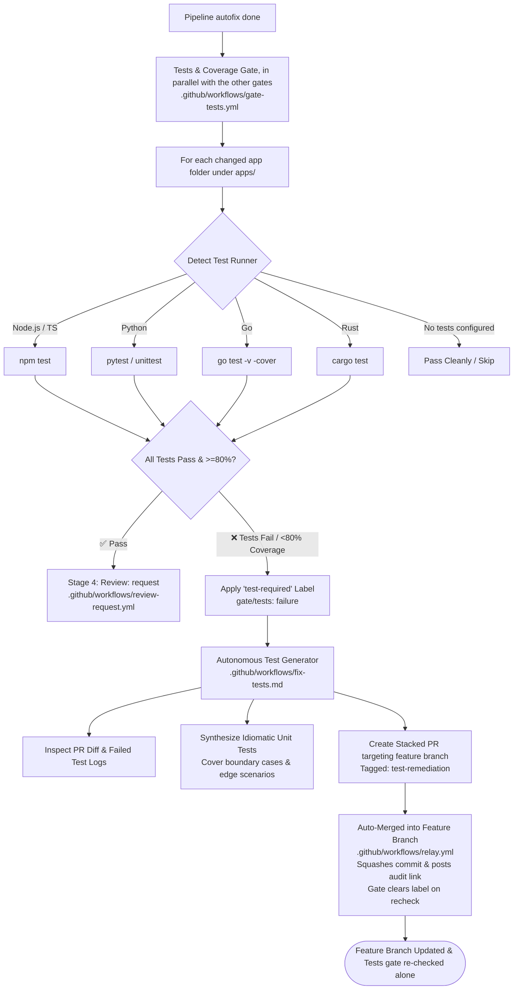

# Step 4: Polyglot Automated Testing & Autonomous Test Generation

This step implements automated testing and coverage validation combined with an autonomous AI remediation loop that drafts missing unit tests and fixes broken assertions.

---

## Architecture Overview

---

## 1. Deterministic Testing Gate (`.github/workflows/gate-tests.yml`)

Projects live in `apps/<app>/` (see [apps/README.md](../apps/README.md)). The test gate lists the app folders the PR changes and, inside each one, discovers and executes the test suite from that app's manifests; diff-scoped lookups use paths relative to the app. A PR that changes nothing under `apps/` (framework-only) passes cleanly. Each app's output starts with `📁 Testing apps/<app>`, which is passed to the tests fixer with the findings so it works in the right folder.

- **Universal & Polyglot**:
  - **Configurable Coverage Threshold**: Configured via repository variable `COVERAGE_THRESHOLD` (e.g. `vars.COVERAGE_THRESHOLD`), defaulting to `80`% if not set.
  - **JavaScript / TypeScript**: Discovers `package.json` configurations and runner configs (`vitest` / `jest`), scoping tests and coverage to PR diff changes (`--changed` / `--changedSince=origin/<base>`) with the configurable line coverage threshold (`--coverage.thresholds.lines` or `--coverageThreshold`), with clean fallback to `npm run test:cov` / `npm test`.
  - **Python**: Scopes pytest coverage to modified source files via `git diff` with `--cov=<changed_modules> --cov-fail-under=${COVERAGE_THRESHOLD}`.
  - **Go**: Scopes `go test` to modified packages via `git diff` and validates that line coverage meets or exceeds `${COVERAGE_THRESHOLD}%`.
  - **Java / Kotlin**: Discovers `pom.xml` (`mvn verify`) or `build.gradle` (`gradle test jacocoTestCoverageVerification`).
  - **C# / .NET**: Discovers `*.csproj` or `*.sln` and runs `dotnet test` with `CoveragePercentTarget=${COVERAGE_THRESHOLD}`.
  - **Rust**: Discovers `Cargo.toml` and runs `cargo test`.
  - **Ruby**: Discovers `Gemfile` and runs `COVERAGE_MIN=${COVERAGE_THRESHOLD} bundle exec rspec`.
  - **PHP**: Discovers `composer.json` and runs `phpunit --min-covered-elements=${COVERAGE_THRESHOLD}`.
  - **Zero Noise**: Repositories without test suites or manifests skip cleanly without failing the check.
- **Fail-Fast & Triggering Remediation**:
  - If test assertions fail, or if test coverage is below the configured threshold, the gate fails and attaches the **`test-required`** label.
  - When all tests pass and coverage requirements are met, the `test-required` label is automatically cleared.

---

## 2. Autonomous Test Generator (`.github/workflows/fix-tests.md`)

When unit tests fail or code changes lack test coverage, this GitHub Agentic Workflow drafts idiomatic unit tests following a structured 5-step protocol:

### Supported Language & Framework Matrix

| Ecosystem | Manifest File(s) | Common Test Frameworks | Typical Test & Coverage Command |
| :--- | :--- | :--- | :--- |
| **TypeScript / JavaScript** | `package.json` | Vitest, Jest, Mocha | `npm test`, `npm run test:coverage`, `npx vitest run --coverage` |
| **Python** | `pyproject.toml`, `requirements.txt`, `setup.py` | Pytest, Unittest | `pytest --cov=.`, `python -m unittest` |
| **Go** | `go.mod` | Go `testing` package, Testify | `go test -coverprofile=coverage.out ./...` |
| **Java / Kotlin** | `pom.xml`, `build.gradle` | JUnit 5, TestNG, Mockito | `./mvnw test`, `./gradlew test jacocoTestReport` |
| **C# / .NET** | `*.csproj`, `*.sln` | xUnit, NUnit, MSTest | `dotnet test --collect:"XPlat Code Coverage"` |
| **Rust** | `Cargo.toml` | Built-in test harness | `cargo test`, `cargo llvm-cov` |
| **Ruby** | `Gemfile` | RSpec, Minitest | `bundle exec rspec`, `rake test` |
| **PHP** | `composer.json` | PHPUnit, Pest | `vendor/bin/phpunit --coverage-text` |

### Execution:
1. **Detect Framework & Runner**: Identifies the project's testing ecosystem and coverage commands from manifests.
2. **Analyze Uncovered PR Diff**: Evaluates newly added/modified functions, conditional branches, error paths, and existing test file conventions (co-located vs centralized).
3. **Implement Comprehensive Tests**: Writes clean, idiomatic unit tests covering happy paths, boundary values, error scenarios, and proper mocks.
4. **Validate Tests Locally**: Executes the test suite locally in the sandbox using `bash` to verify zero test regressions and ≥80% coverage before opening the PR.
5. **Propose Stacked PR**: Opens a batched stacked PR targeting the author's feature branch containing only test files, accompanied by an explanatory parent PR comment.

- **🔒 Strict Guardrail: Test Files Only**:
  - **The agent is strictly prohibited from modifying production or application code.**
  - It may only create or modify test files. If an existing test fails, it must adapt the test assertion—never rewrite application logic to make tests pass.
